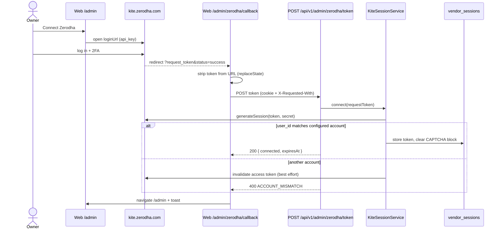
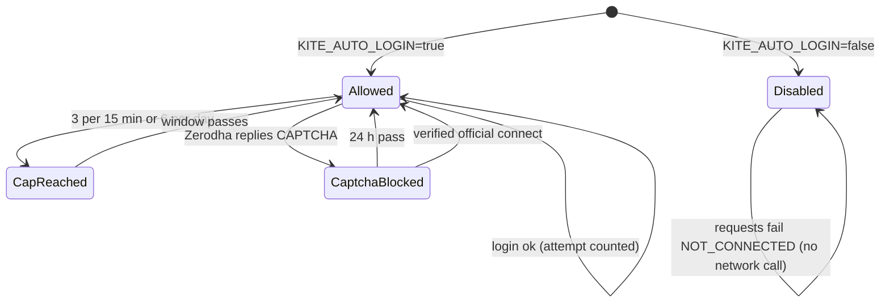

# Zerodha connection (admin-ops + `shared/vendors/kite`)

**Purpose:** keep one valid Kite access token for the whole system without putting the owner's Zerodha account at risk.
**SRD:** FR-MD-5, E3, NFR-SC-1, FR-AC-2.

## Rules
- **Official Connect Zerodha is the primary path.** Scripted auto-login is off by default (`KITE_AUTO_LOGIN=false`) and is meant only for the server's static IP.
- **A CAPTCHA reply blocks all scripted logins for 24 h.** It is persisted, so a restart doesn't clear it. Only a verified official or manual connect clears it.
- **Scripted logins are capped** at 3 per 15 min and 6 per day, persisted in `vendor_sessions`.
- **Only the configured account is accepted.** A token from another Zerodha account is invalidated (best effort) and rejected with 400 `ACCOUNT_MISMATCH`; nothing is stored.
- **There is no API callback.** The session cookie is `SameSite=Strict` and isn't sent on Zerodha's cross-site redirect, so the web page `/admin/zerodha/callback` posts the token same-site.

## Connect flow

## Scripted-login lock

