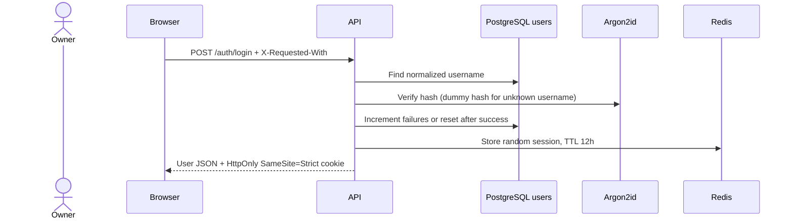
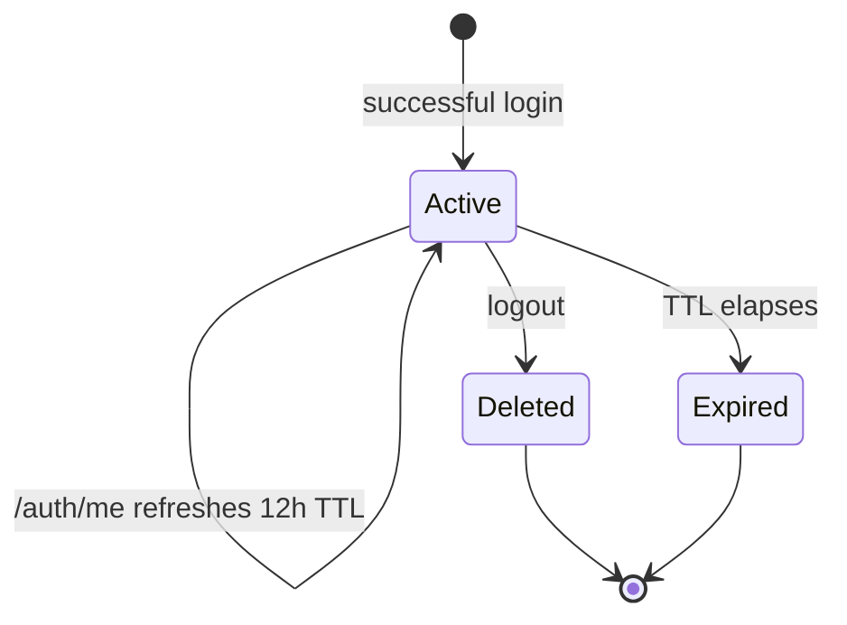
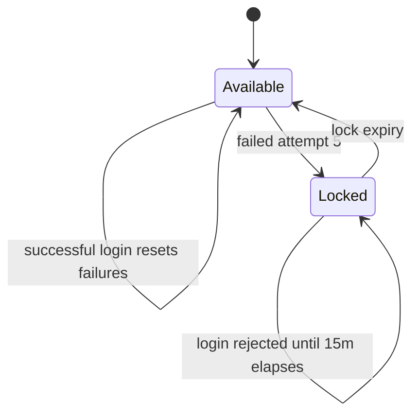

# Authentication

Implements username sign-in, role checks, admin account setup, and sliding Redis sessions. SRD: FR-AC-1, NFR-SC-1, NFR-SC-5.

## Login sequence

## Session lifecycle

## Lockout states

