# Foundation

Shared application foundations support the API and web shell (SRD §10, §14;
AGENTS.md §7).

## Config
The API validates environment input once at startup (SRD §10.1, R-9).
`loadConfig` ignores unknown keys, applies defaults, parses ports and HTTP(S)
origins, and freezes the typed config. The global `APP_CONFIG` provider shares
that object. Invalid input produces one `ConfigError` listing every invalid key
with fixed descriptions that never include secret values (NFR-SC-1).

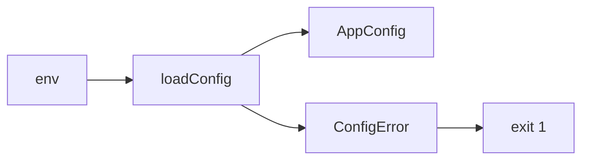

## Errors
Shared contracts define eleven stable codes and a strict error body (SRD ?11,
NFR-SC-1, AGENTS.md ?3). The API global filter emits only the public body;
unknown errors never expose messages, SQL or stacks. Pino receives structured warnings for domain errors and error codes for unexpected errors.

| Thrown value / HTTP status | Response status | Code | Message / details |
|---|---|---|---|
| DomainError | Declared status | Declared code | Declared message and optional details |
| ZodError | 422 | VALIDATION_FAILED | Validation failed; fields with dotted paths |
| HttpException 400, 422 | Same | VALIDATION_FAILED | Exception message |
| HttpException 401 | 401 | UNAUTHORIZED | Exception message |
| HttpException 403 | 403 | FORBIDDEN | Exception message |
| HttpException 404 | 404 | NOT_FOUND | Exception message |
| HttpException 409 | 409 | CONFLICT | Exception message |
| HttpException 429 | 429 | RATE_LIMITED | Exception message |
| HttpException 503 | 503 | UNAVAILABLE | Internal error |
| Other HttpException | Same | INTERNAL | Internal error for 5xx; otherwise exception message |
| Any other value | 500 | INTERNAL | Internal error; no details |

The filter reads request.id (unknown outside HTTP middleware). RateLimitedError sets Retry-After to ceil(retryAfterMs / 1000).

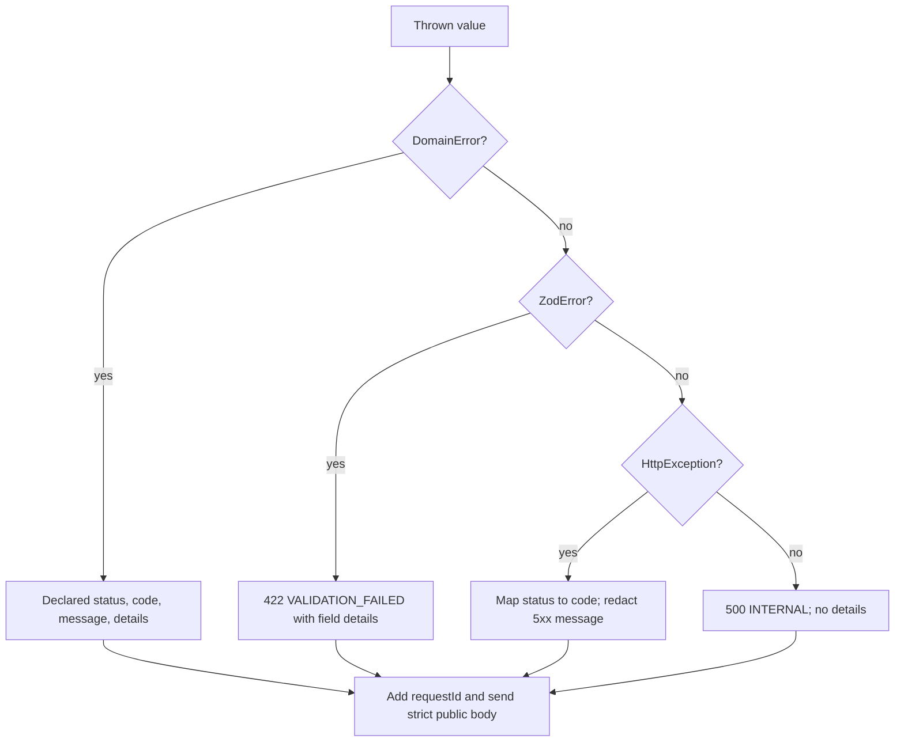

## Observability

NFR-OB-1, SRD ?11: global nestjs-pino emits JSON at APP_CONFIG.LOG_LEVEL.
The edge accepts a single request ID matching `[A-Za-z0-9_-]{1,64}` or generates
a UUID. Every response carries x-request-id. Authorization, cookie and set-cookie
headers are redacted. Bootstrap routes Nest logs through pino.

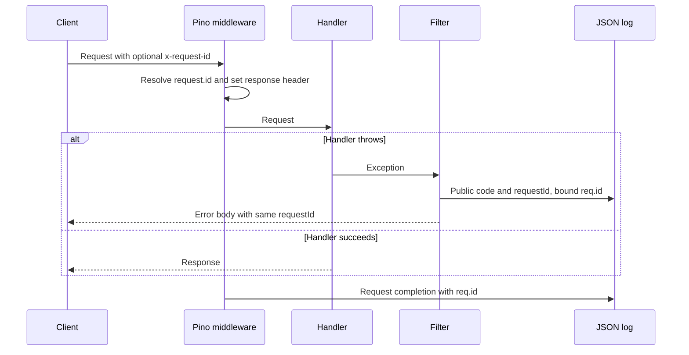

## Database

SRD ?10.4, NFR-RB-1/3/6/7 and E17: global DB exposes Drizzle over a lazy
Postgres pool. DATABASE_POOL_MAX defaults to 10 (1?100); connection timeout is
3 s, idle timeout 30 s, and every session has statement_timeout=5000.
Readiness runs select 1 with a 1500 ms deadline. An aborted check destroys its
connection; acquisition completing after the deadline releases its connection.
Failed probes use full-jitter backoff (200 ms base, 10 s cap) before the next
readiness request can reconnect. Idle connection errors are logged without
terminating the process. Shutdown ends the pool. Schema and migrations are empty.

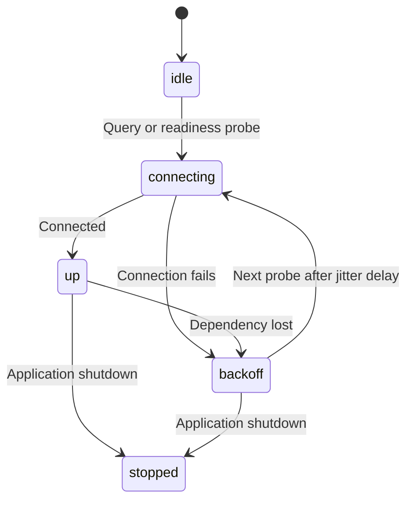

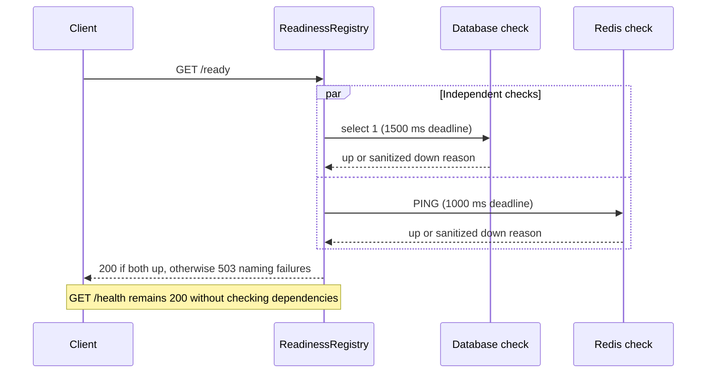

## Resilience

The dependency-free `@aitrader/resilience` package provides full-jitter backoff
and retries (NFR-RB-1), circuit breaking (NFR-RB-2), abortable sleep and deadlines
(NFR-RB-3), and token-bucket rate limiting (NFR-SC-5). Clocks and randomness are
injectable. Retry callbacks use the zero-based failed attempt. Ignored breaker
errors pass through without counting; an ignored probe error releases the probe
slot and leaves the breaker half-open. Concurrent probe callers fail immediately
with zero remaining wait once the open interval has expired.

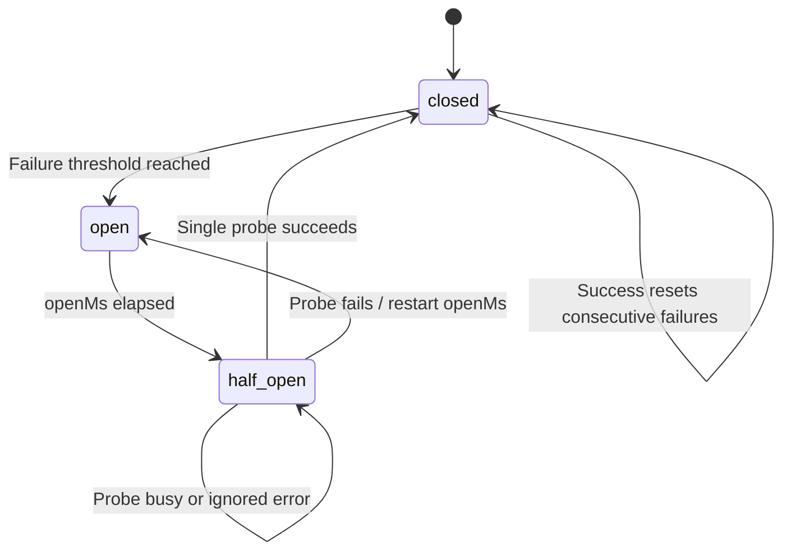

## Redis

SRD ?10.4, NFR-RB-1/3/6/7 and E18: global REDIS exposes ioredis with lazyConnect,
maxRetriesPerRequest=1, enableOfflineQueue=false, connectTimeout=3000 and a
1000 ms command timeout. Module initialization starts connecting without waiting.
The retry strategy never stops: full jitter, 200 ms base and 10 s cap. Error
warnings are limited to one per 10 s. PING readiness has a 1000 ms deadline.
Shutdown attempts QUIT with a 1500 ms deadline, then disconnects, including when
the dependency is unavailable.

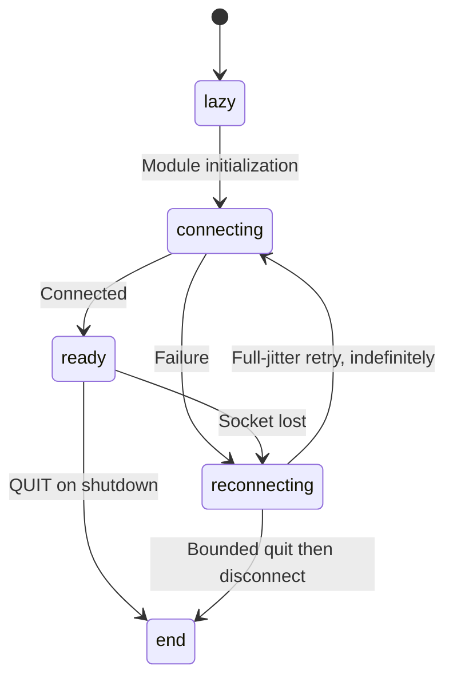

## Health

NFR-RB-6: /health returns 200 without running dependencies. The global
ReadinessRegistry lets later modules register named checks without changing
health. Duplicate names throw. /ready runs checks in parallel with a per-check
2,000 ms default timeout; throws and timeouts return down with a reason capped
at 200 characters. Timers are cleared after completion. No checks means ready.
Timeout bounds waiting; the check interface does not support cancellation.

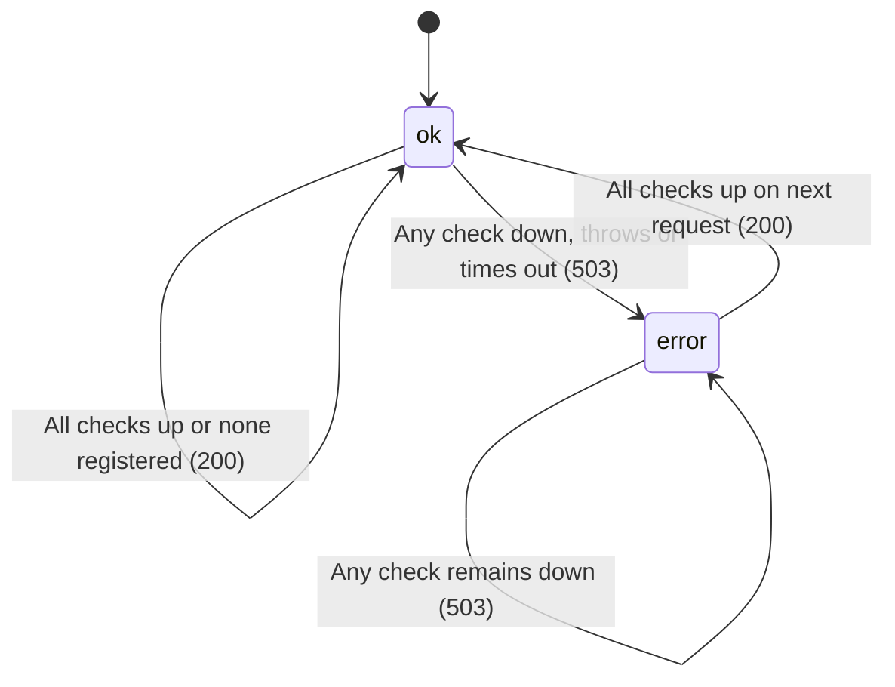

## Web shell

FR-UI-1/3/4/5/6, SRD §10.3, NFR-PF-5: code-based typed routing and
responsive terminal placeholders provide the foundation for future features.
The API client validates JSON contracts, preserves aborts, maps transport errors,
and bounds requests to 15 seconds. Query defaults retry only transient API codes.
Storage is optional; theme mode is applied before the first render.

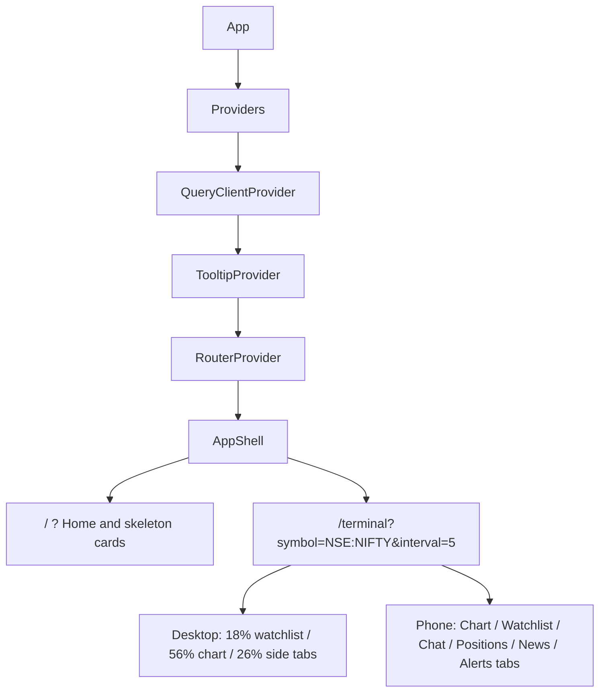

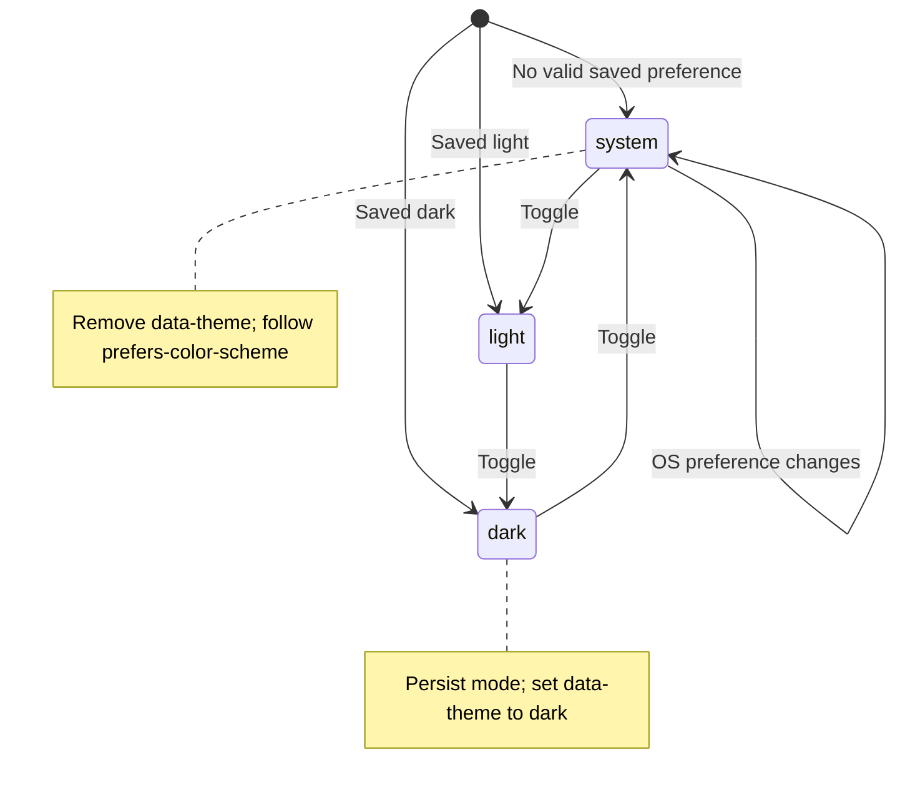

## Live store
lands in T-0xx

## Diagram regeneration (SRD §14)

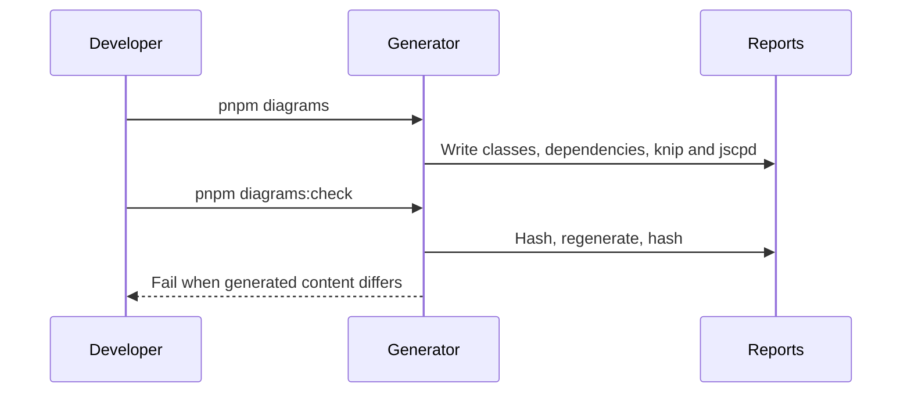
