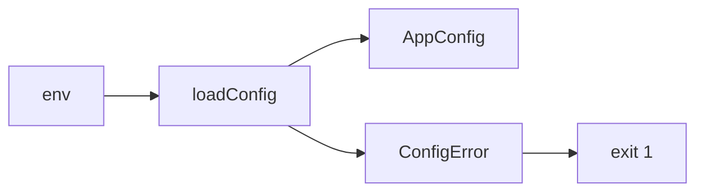
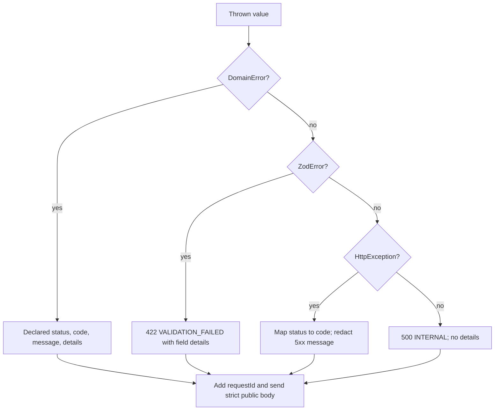
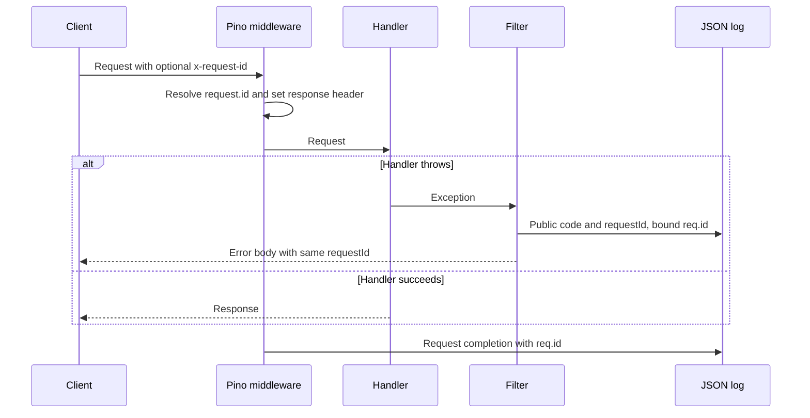
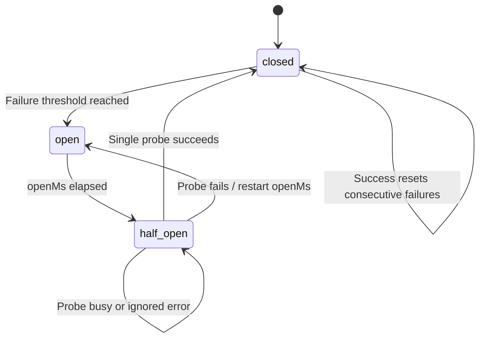
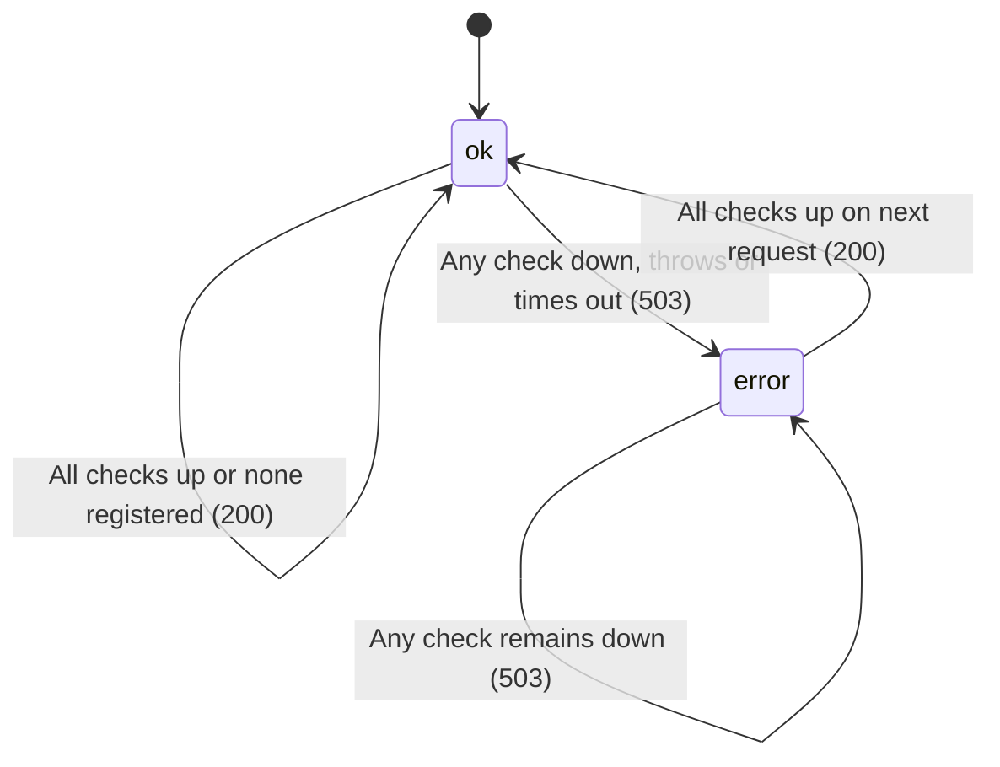
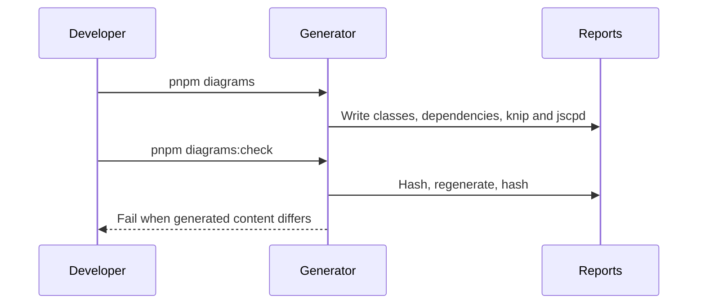

# Foundation

Shared application foundations support the API and web shell (SRD §10, §14;
AGENTS.md §7).

## Config
The API validates environment input once at startup (SRD §10.1, R-9).
`loadConfig` ignores unknown keys, applies defaults, parses ports and HTTP(S)
origins, and freezes the typed config. The global `APP_CONFIG` provider shares
that object. Invalid input produces one `ConfigError` listing every invalid key
with fixed descriptions that never include secret values (NFR-SC-1).

## Errors
Shared contracts define eleven stable codes and a strict error body (SRD ?11,
NFR-SC-1, AGENTS.md ?3). The API global filter emits only the public body;
unknown errors never expose messages, SQL or stacks. Pino receives structured warnings for domain errors and error codes for unexpected errors.

| Thrown value / HTTP status | Response status | Code | Message / details |
|---|---|---|---|
| DomainError | Declared status | Declared code | Declared message and optional details |
| ZodError | 422 | VALIDATION_FAILED | Validation failed; fields with dotted paths |
| HttpException 400, 422 | Same | VALIDATION_FAILED | Exception message |
| HttpException 401 | 401 | UNAUTHORIZED | Exception message |
| HttpException 403 | 403 | FORBIDDEN | Exception message |
| HttpException 404 | 404 | NOT_FOUND | Exception message |
| HttpException 409 | 409 | CONFLICT | Exception message |
| HttpException 429 | 429 | RATE_LIMITED | Exception message |
| HttpException 503 | 503 | UNAVAILABLE | Internal error |
| Other HttpException | Same | INTERNAL | Internal error for 5xx; otherwise exception message |
| Any other value | 500 | INTERNAL | Internal error; no details |

The filter reads request.id (unknown outside HTTP middleware). RateLimitedError sets Retry-After to ceil(retryAfterMs / 1000).

## Observability

NFR-OB-1, SRD ?11: global nestjs-pino emits JSON at APP_CONFIG.LOG_LEVEL.
The edge accepts a single request ID matching `[A-Za-z0-9_-]{1,64}` or generates
a UUID. Every response carries x-request-id. Authorization, cookie and set-cookie
headers are redacted. Bootstrap routes Nest logs through pino.

## Database
lands in T-0xx

## Resilience

The dependency-free `@aitrader/resilience` package provides full-jitter backoff
and retries (NFR-RB-1), circuit breaking (NFR-RB-2), abortable sleep and deadlines
(NFR-RB-3), and token-bucket rate limiting (NFR-SC-5). Clocks and randomness are
injectable. Retry callbacks use the zero-based failed attempt. Ignored breaker
errors pass through without counting; an ignored probe error releases the probe
slot and leaves the breaker half-open. Concurrent probe callers fail immediately
with zero remaining wait once the open interval has expired.

## Redis
lands in T-0xx

## Health

NFR-RB-6: /health returns 200 without running dependencies. The global
ReadinessRegistry lets later modules register named checks without changing
health. Duplicate names throw. /ready runs checks in parallel with a per-check
2,000 ms default timeout; throws and timeouts return down with a reason capped
at 200 characters. Timers are cleared after completion. No checks means ready.
Timeout bounds waiting; the check interface does not support cancellation.

## Web shell
lands in T-0xx

## Live store
lands in T-0xx

## Diagram regeneration (SRD §14)

