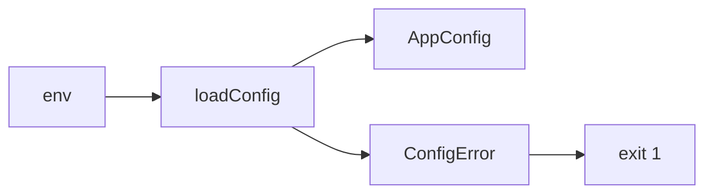
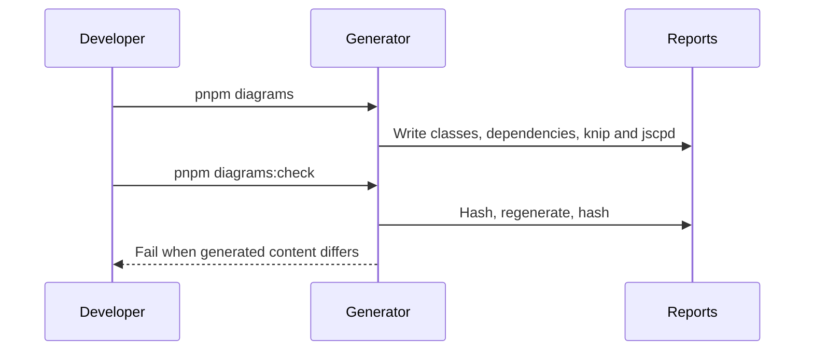

# Foundation

Shared application foundations support the API and web shell (SRD §10, §14;
AGENTS.md §7).

## Config
The API validates environment input once at startup (SRD §10.1, R-9).
`loadConfig` ignores unknown keys, applies defaults, parses ports and HTTP(S)
origins, and freezes the typed config. The global `APP_CONFIG` provider shares
that object. Invalid input produces one `ConfigError` listing every invalid key
with fixed descriptions that never include secret values (NFR-SC-1).

## Errors
lands in T-0xx

## Observability
lands in T-0xx

## Database
lands in T-0xx

## Redis
lands in T-0xx

## Health
lands in T-0xx

## Web shell
lands in T-0xx

## Live store
lands in T-0xx

## Diagram regeneration (SRD §14)

