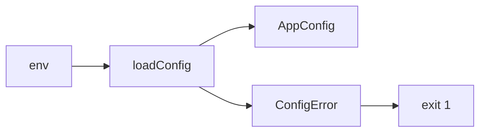
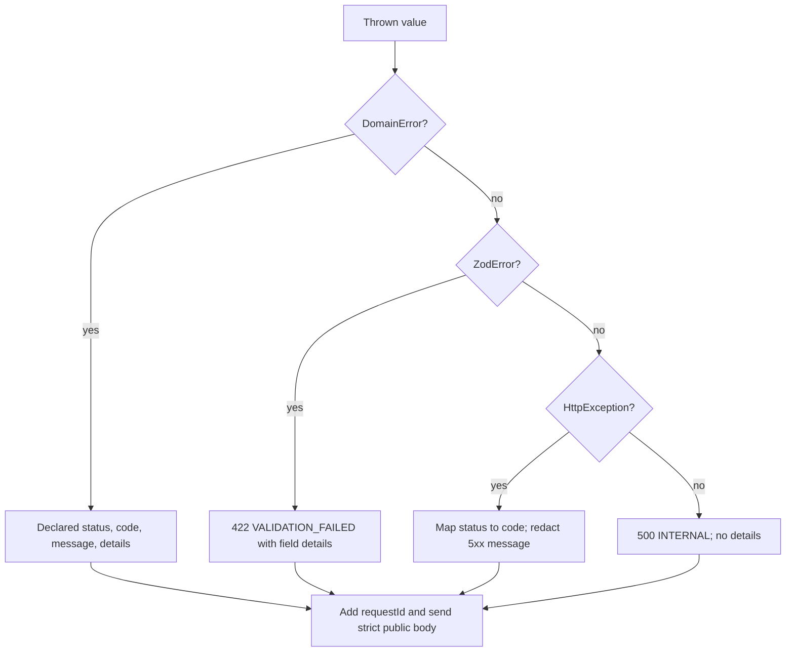
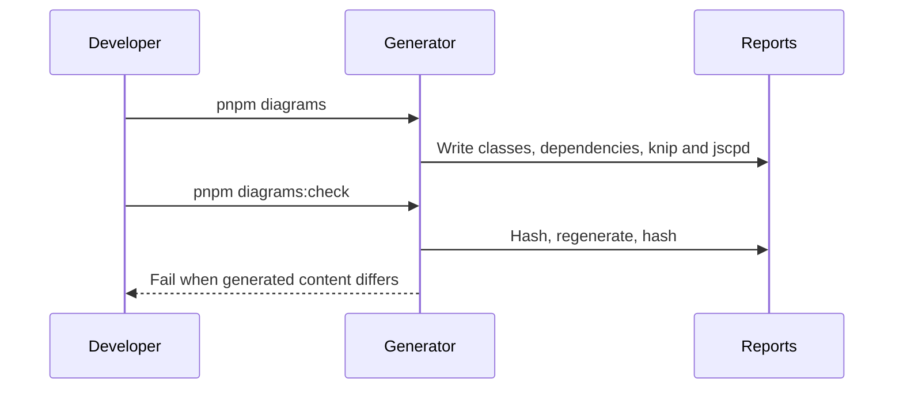

# Foundation

Shared application foundations support the API and web shell (SRD §10, §14;
AGENTS.md §7).

## Config
The API validates environment input once at startup (SRD §10.1, R-9).
`loadConfig` ignores unknown keys, applies defaults, parses ports and HTTP(S)
origins, and freezes the typed config. The global `APP_CONFIG` provider shares
that object. Invalid input produces one `ConfigError` listing every invalid key
with fixed descriptions that never include secret values (NFR-SC-1).

## Errors
Shared contracts define eleven stable codes and a strict error body (SRD ?11,
NFR-SC-1, AGENTS.md ?3). The API global filter emits only the public body;
unknown errors never expose messages, SQL or stacks. Nest Logger receives
warnings for domain errors and server-side stacks for unexpected errors.

| Thrown value / HTTP status | Response status | Code | Message / details |
|---|---|---|---|
| DomainError | Declared status | Declared code | Declared message and optional details |
| ZodError | 422 | VALIDATION_FAILED | Validation failed; fields with dotted paths |
| HttpException 400, 422 | Same | VALIDATION_FAILED | Exception message |
| HttpException 401 | 401 | UNAUTHORIZED | Exception message |
| HttpException 403 | 403 | FORBIDDEN | Exception message |
| HttpException 404 | 404 | NOT_FOUND | Exception message |
| HttpException 409 | 409 | CONFLICT | Exception message |
| HttpException 429 | 429 | RATE_LIMITED | Exception message |
| HttpException 503 | 503 | UNAVAILABLE | Internal error |
| Other HttpException | Same | INTERNAL | Internal error for 5xx; otherwise exception message |
| Any other value | 500 | INTERNAL | Internal error; no details |

Request ID precedence is non-empty request.id, non-empty x-request-id, then
unknown. RateLimitedError sets Retry-After to ceil(retryAfterMs / 1000).
Request ID generation and pino remain T-007.

## Observability
lands in T-0xx

## Database
lands in T-0xx

## Redis
lands in T-0xx

## Health
lands in T-0xx

## Web shell
lands in T-0xx

## Live store
lands in T-0xx

## Diagram regeneration (SRD §14)

