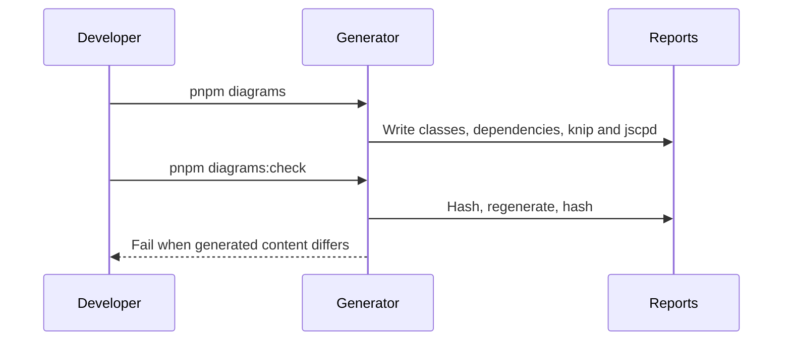

# Foundation

Shared application foundations support the API and web shell (SRD §10, §14;
AGENTS.md §7). No foundation runtime flows exist yet.

## Config
lands in T-0xx

## Errors
lands in T-0xx

## Observability
lands in T-0xx

## Database
lands in T-0xx

## Redis
lands in T-0xx

## Health
lands in T-0xx

## Web shell
lands in T-0xx

## Live store
lands in T-0xx

## Diagram regeneration (SRD §14)

