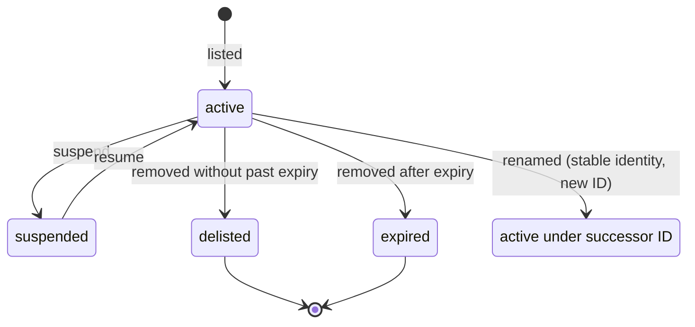
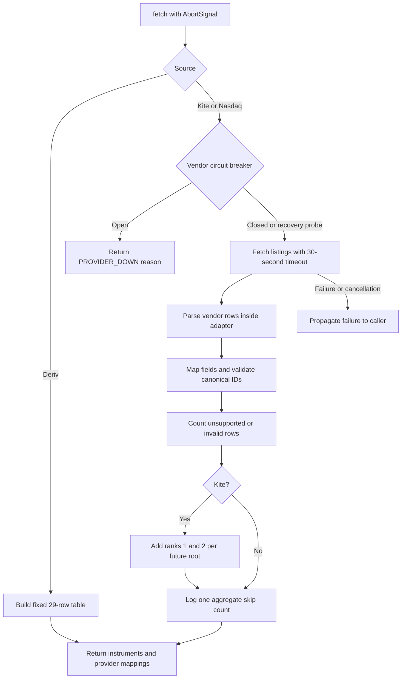

# Instruments domain

Pure, deterministic instrument IDs, master fields, change detection and continuous-futures resolution. No framework or I/O. Implements FR-SY-1, FR-SY-2, FR-SY-4, FR-SY-5 and the domain portion of E23.

## Canonical ID parsing (FR-SY-1)

| Part | Rule |
| --- | --- |
| Input | Trim surrounding whitespace. |
| Separator | Split on the first colon; exchange and ticker must both be non-empty. Additional colons belong to the ticker. |
| Exchange | Uppercase; match `^[A-Z0-9_]{1,20}$`. |
| Ticker length | 1–64 characters. |
| Ticker characters | Reject U+0000–U+001F and U+007F; preserve inner spaces and punctuation. |
| Ticker case | Preserve case unless the whole input has no uppercase letter; then uppercase the ticker. |
| Failure | Throw framework-free `InvalidInstrumentIdError` with raw input, reason and `VALIDATION_FAILED`; `tryParse` returns null. |

## Master changes (FR-SY-4, E23)

Compare IDs first. Missing IDs with a matching stable identity (exchange plus ISIN by default, caller-supplied identity otherwise) produce a rename only when the successor ID was absent from the previous master, suppressing the successor's listing. Custom identity scoping is the caller's responsibility; the new-ID restriction always applies. Other missing IDs are expired only when expiry precedes the timestamp's date; otherwise they are delisted. New IDs are listed, and deep changes to any non-ID field are updated. Results sort by renamed, delisted, expired, listed, updated, then ID. Every change carries the caller's timestamp.

The diagram describes instrument status and rename history; this task models and detects changes without persisting or applying status transitions.

## Continuous futures (FR-SY-5, E23)

Continuous tickers end in a rank from 1 through 9 followed by `!`. Resolution selects futures with an underlying ticker equal to the root, falling back to a ticker prefix only when no underlying is present. Contracts must have expiry on or after the caller's date. Sort by ascending expiry and select rank minus one; return null when unavailable. The expiry date itself remains tradable; the following day rolls to the next contract.

## Instrument sources (FR-SY-1, FR-SY-2, FR-SY-3, FR-SY-5, FR-MD-1, R-11)

`InstrumentSource.fetch(signal)` returns a fresh canonical snapshot and one mapping per instrument/provider. Repeating a fetch over the same listings and clock date produces the same data; sources perform no writes. `INSTRUMENT_SOURCES` identifies the source array for later DI wiring. Storage, refresh orchestration and search belong to later tasks.

| Vendor row | Canonical mapping | Fields and identity |
| --- | --- | --- |
| Kite NSE `RELIANCE`, tick size 0.1 | `NSE:RELIANCE` | Stock, INR, pricescale 10, lot size 1. A tick size of 0.05 gives pricescale 20. |
| Kite NSE `ARE&M`, `OMFURN-SM` | `NSE:ARE&M`, `NSE:OMFURN-SM` | Preserve punctuation and series suffixes; keep the row lot size (1200 for OMFURN-SM). |
| Kite NSE `NIFTYBEES` | `NSE:NIFTYBEES` | ETF when the name matches `\bETF\b` or ends in BEES. |
| Kite index `NIFTY 50`, `NIFTY BANK`, `NIFTY FIN SERVICE`, `NIFTY IT`, `INDIA VIX`, BSE `SENSEX` | `NSE:NIFTY`, `NSE:BANKNIFTY`, `NSE:CNXFINANCE`, `NSE:CNXIT`, `NSE:INDIAVIX`, `BSE:SENSEX` | Index, pricescale 100, lot size 1, no volume; differing original names become aliases. Other indices remove spaces and preserve `&`. |
| Kite NFO `NIFTY26NOVFUT` | `NSE:NIFTYX2026` | Futures; November month code X, expiry 2026-11-23, underlying `NSE:NIFTY`. Original symbol becomes an alias. |
| Kite MCX `GOLD26DECFUT` | `MCX:GOLDZ2026` | Commodity future, expiry 2026-12-04, underlying `MCX:GOLD`. Month codes January through December: F G H J K M N Q U V X Z. |
| Kite NFO `NIFTY26N0925050CE` | `NSE:NIFTY261109C25050` | Option, expiry 2026-11-09, strike 25050, optionType CE, underlying `NSE:NIFTY`; PE uses P. Decimal strikes retain significant decimals. |
| Kite MCX `GOLD26NOV166000PE` | `MCX:GOLD261127P166000` | Option, expiry 2026-11-27, strike 166000, underlying `MCX:GOLD`. |
| Each Kite dated-future root | `MCX:GOLD1!`, `MCX:GOLD2!`, `NSE:NIFTY1!`, etc. | Two synthetic continuous instruments without expiry, mapped to `continuous:<exchange>:<root>:<rank>`; runtime resolution remains in `resolveContinuous`. |
| Deriv `frxEURUSD`, `frxUSDJPY` | `FX:EURUSD`, `FX:USDJPY` | Forex, tick volume, UTC, 24x5, quote currency; pricescale 100000 or 1000 for JPY quotes. |
| Deriv `frxXAUUSD` | `OANDA:XAUUSD` | Metal, Gold/USD, USD, pricescale 100; four metals plus 25 forex pairs form a fixed table. |
| Nasdaq listed `AAPL`, `QQQ` | `NASDAQ:AAPL`, `NASDAQ:QQQ` | Stock or ETF according to the ETF column. |
| Nasdaq other-listed `BRK.B` (N), `GLD` (P), `AAAA` (Z) | `NYSE:BRK.B`, `NYSEARCA:GLD`, `CBOE:AAAA` | Preserve symbols. Other exchange codes: A maps to AMEX, V maps to IEX; unknown codes are counted and skipped. |

Real Kite mappings retain `<vendor exchange>:<tradingsymbol>` and `providerToken = <exchange_token>/<instrument_token>`. This combines stable rename identity and the later websocket token without creating a second mapping. Vendor-specific interpretation stays in the Kite adapter. Indian instruments use Asia/Kolkata and session 0915-1530. Dated instruments whose expiry precedes the injected Kolkata date are expired; synthetic contracts remain active. US instruments use USD, America/New_York, session 0930-1600, pricescale 100 and real volume.

Kite fetches public NSE, BSE, MCX and NFO dumps with `X-Kite-Version: 3`. Its RFC 4180 parser handles quoted commas, escaped quotes and embedded newlines, with Zod validation at the boundary. Unsupported segments/types and invalid IDs are counted. Nasdaq ignores headers and creation-time footers, counting test issues and unknown exchanges as skips. Each network source logs one numeric aggregate skip count per successful snapshot. Deriv makes no network requests.

Each default outbound call has a 30-second timeout covering the body and propagates caller cancellation. Each network source has an independent circuit breaker opening after three failures for 15 minutes (E6); an open breaker returns `UNAVAILABLE` with typed reason `PROVIDER_DOWN`. Errors propagate to the caller, which can retain the previous snapshot in P1-5. No source reads credentials or requires Kite login.

