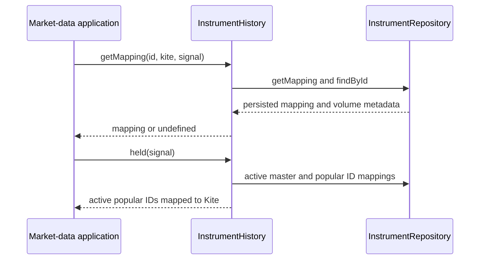
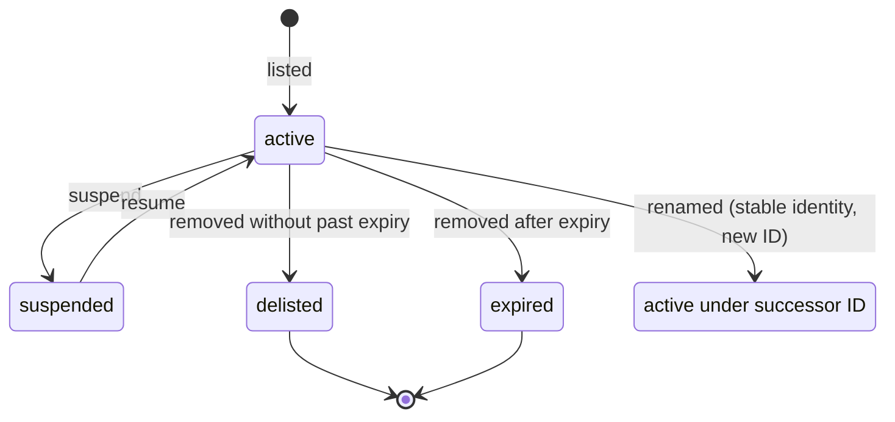
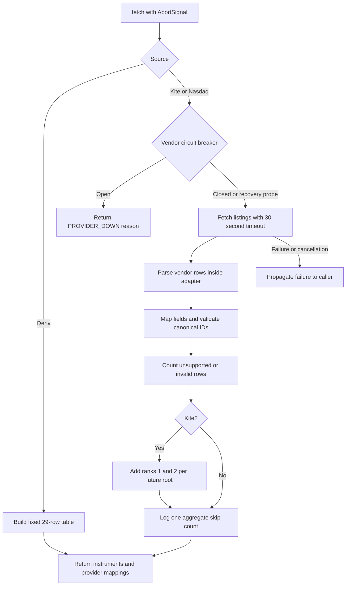
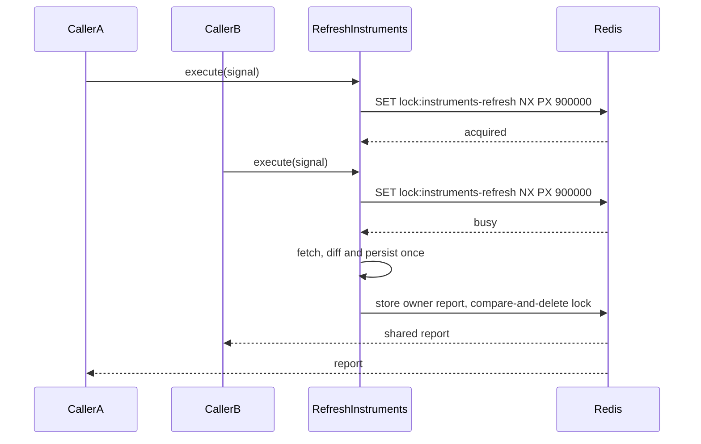
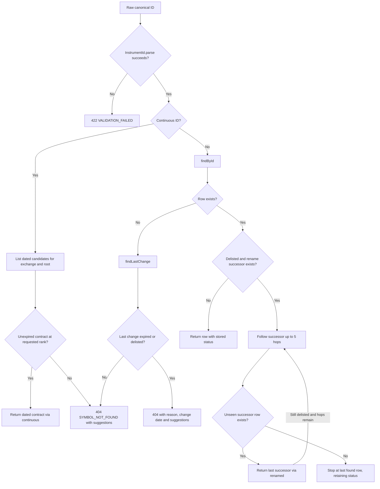
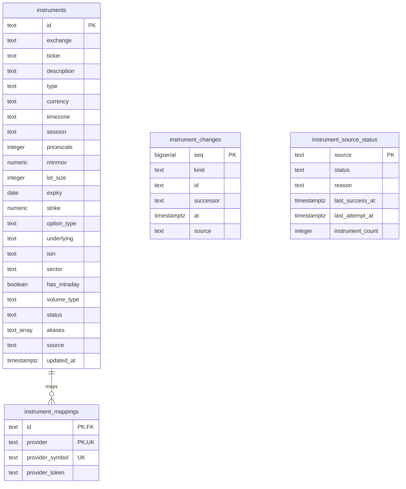
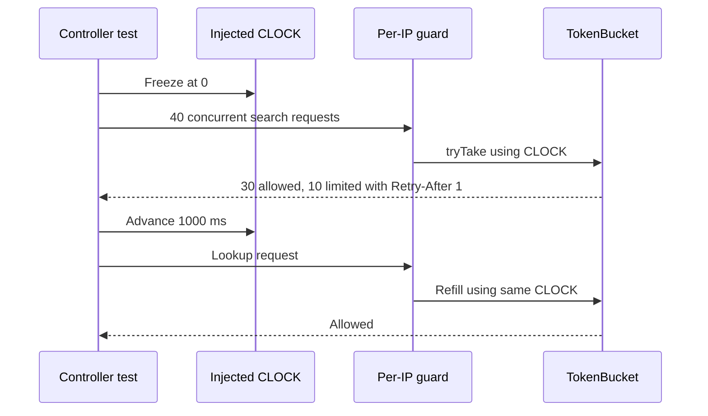

# Instruments domain

P2-4 adds the public `InstrumentHistory` application API (FR-MD-1, FR-MD-2).
`getMapping(id, provider, signal)` returns provider mapping plus canonical volume
metadata; `held(signal)` selects active popular-list IDs with Kite mappings.
The instruments module exports this service globally so other modules inject
the application API without importing infrastructure or module internals (R-5).



Pure, deterministic instrument IDs, master fields, change detection and continuous-futures resolution. No framework or I/O. Implements FR-SY-1, FR-SY-2, FR-SY-4, FR-SY-5 and the domain portion of E23.

## Canonical ID parsing (FR-SY-1)

| Part | Rule |
| --- | --- |
| Input | Trim surrounding whitespace. |
| Separator | Split on the first colon; exchange and ticker must both be non-empty. Additional colons belong to the ticker. |
| Exchange | Uppercase; match `^[A-Z0-9_]{1,20}$`. |
| Ticker length | 1–64 characters. |
| Ticker characters | Reject U+0000–U+001F and U+007F; preserve inner spaces and punctuation. |
| Ticker case | Preserve case unless the whole input has no uppercase letter; then uppercase the ticker. |
| Failure | Throw framework-free `InvalidInstrumentIdError` with raw input, reason and `VALIDATION_FAILED`; `tryParse` returns null. |

## Master changes (FR-SY-4, E23)

Compare IDs first. Missing IDs with a matching stable identity (exchange plus ISIN by default, caller-supplied identity otherwise) produce a rename only when the successor ID was absent from the previous master, suppressing the successor's listing. Custom identity scoping is the caller's responsibility; the new-ID restriction always applies. Other missing IDs are expired only when expiry precedes the timestamp's date; otherwise they are delisted. New IDs are listed, and deep changes to any non-ID field are updated. Results sort by renamed, delisted, expired, listed, updated, then ID. Every change carries the caller's timestamp.



Status transitions and rename successors are persisted per source, with append-only change history.

## Continuous futures (FR-SY-5, E23)

Continuous tickers end in a rank from 1 through 9 followed by `!`. Resolution selects dated futures or commodities with an underlying ticker equal to the root, falling back to a ticker prefix only when no underlying is present. Options and undated instruments are excluded. Contracts must have expiry on or after the caller's date. Sort by ascending expiry and select rank minus one; return null when unavailable. The expiry date itself remains tradable; the following day rolls to the next contract.


## Instrument sources (FR-SY-1, FR-SY-2, FR-SY-3, FR-SY-5, FR-MD-1, R-11)

`InstrumentSource.fetch(signal)` returns a fresh canonical snapshot and one mapping per instrument/provider. Repeating a fetch over the same listings and clock date produces the same data; sources perform no writes. `INSTRUMENT_SOURCES` registers Kite, Deriv and Nasdaq in `InstrumentsModule`. Search implementation belongs to P1-6.

| Vendor row | Canonical mapping | Fields and identity |
| --- | --- | --- |
| Kite NSE `RELIANCE`, tick size 0.1 | `NSE:RELIANCE` | Stock, INR, pricescale 10, lot size 1. A tick size of 0.05 gives pricescale 20. |
| Kite NSE `ARE&M`, `OMFURN-SM` | `NSE:ARE&M`, `NSE:OMFURN-SM` | Preserve punctuation and series suffixes; keep the row lot size (1200 for OMFURN-SM). |
| Kite NSE `NIFTYBEES` | `NSE:NIFTYBEES` | ETF when the name matches `\bETF\b` or ends in BEES. |
| Kite index `NIFTY 50`, `NIFTY BANK`, `NIFTY FIN SERVICE`, `NIFTY IT`, `INDIA VIX`, BSE `SENSEX` | `NSE:NIFTY`, `NSE:BANKNIFTY`, `NSE:CNXFINANCE`, `NSE:CNXIT`, `NSE:INDIAVIX`, `BSE:SENSEX` | Index, pricescale 100, lot size 1, no volume; differing original names become aliases. Other indices remove spaces and preserve `&`. |
| Kite NFO `NIFTY26NOVFUT` | `NSE:NIFTYX2026` | Futures; November month code X, expiry 2026-11-23, underlying `NSE:NIFTY`. Original symbol becomes an alias. |
| Kite MCX `GOLD26DECFUT` | `MCX:GOLDZ2026` | Commodity future, expiry 2026-12-04, underlying `MCX:GOLD`. Month codes January through December: F G H J K M N Q U V X Z. |
| Kite NFO `NIFTY26N0925050CE` | `NSE:NIFTY261109C25050` | Option, expiry 2026-11-09, strike 25050, optionType CE, underlying `NSE:NIFTY`; PE uses P. Decimal strikes retain significant decimals. |
| Kite MCX `GOLD26NOV166000PE` | `MCX:GOLD261127P166000` | Option, expiry 2026-11-27, strike 166000, underlying `MCX:GOLD`. |
| Each Kite dated-future root | `MCX:GOLD1!`, `MCX:GOLD2!`, `NSE:NIFTY1!`, etc. | Two synthetic continuous instruments without expiry, mapped to `continuous:<exchange>:<root>:<rank>`; runtime resolution remains in `resolveContinuous`. |
| Deriv `frxEURUSD`, `frxUSDJPY` | `FX:EURUSD`, `FX:USDJPY` | Forex, tick volume, UTC, 24x5, quote currency; pricescale 100000 or 1000 for JPY quotes. |
| Deriv `frxXAUUSD` | `OANDA:XAUUSD` | Metal, Gold/USD, USD, pricescale 100; four metals plus 25 forex pairs form a fixed table. |
| Nasdaq listed `AAPL`, `QQQ` | `NASDAQ:AAPL`, `NASDAQ:QQQ` | Stock or ETF according to the ETF column. |
| Nasdaq other-listed `BRK.B` (N), `GLD` (P), `AAAA` (Z) | `NYSE:BRK.B`, `NYSEARCA:GLD`, `CBOE:AAAA` | Preserve symbols. Other exchange codes: A maps to AMEX, V maps to IEX; unknown codes are counted and skipped. |

Real Kite mappings retain `<vendor exchange>:<tradingsymbol>` and `providerToken = <exchange_token>/<instrument_token>`. This combines stable rename identity and the later websocket token without creating a second mapping. Vendor-specific interpretation stays in the Kite adapter. Indian instruments use Asia/Kolkata and session 0915-1530. Dated instruments whose expiry precedes the injected Kolkata date are expired; synthetic contracts remain active. US instruments use USD, America/New_York, session 0930-1600, pricescale 100 and real volume.

Kite fetches public NSE, BSE, MCX and NFO dumps with `X-Kite-Version: 3`. Its RFC 4180 parser handles quoted commas, escaped quotes and embedded newlines, with Zod validation at the boundary. Unsupported segments/types and invalid IDs are counted. Nasdaq ignores headers and creation-time footers, counting test issues and unknown exchanges as skips. Each network source logs one numeric aggregate skip count per successful snapshot. Deriv makes no network requests.

Each default outbound call has a 30-second timeout covering the body and propagates caller cancellation. Each network source has an independent circuit breaker opening after three failures for 15 minutes (E6); an open breaker returns `UNAVAILABLE` with typed reason `PROVIDER_DOWN`. Errors propagate to the caller, which can retain the previous snapshot in P1-5. No source reads credentials or requires Kite login.



## Persistence and daily refresh (FR-SY-2/3/4, NFR-RB-4/5)

`RefreshInstruments.execute` holds the Redis `lock:instruments-refresh` key with
`SET NX PX` for up to 15 minutes. The owner releases it with compare-and-delete
and publishes its report under an owner-scoped result key. Concurrent callers
wait up to 60 seconds and receive that same report; a local in-flight promise
also coalesces callers in one process (NFR-RB-4/5).



`instruments-refresh` runs at 07:00 Asia/Kolkata with six hours of catch-up grace and a ten-minute runtime limit. Bootstrap registers the job in the background and requests an immediate run when the instrument table is empty. Source status is exposed through independent readiness checks; liveness stays available. Application use cases depend on repository and search ports. The Drizzle adapter owns SQL and transaction boundaries; the Kite adapter supplies an identity factory using exchange-scoped exchange tokens, while the other sources supply no identity.

Only active and suspended source rows enter the previous master, so removal changes are recorded once. Incoming listed rows become active. Instrument upserts skip identical values (including preserving updated_at), mappings are replaced within the same source transaction, and change history remains append-only. Each insertion batch contains at most 1,000 rows. Expired dated derivatives older than 30 days are purged with cascading mappings; history remains. The search port receives active, suspended and recently expired rows after the purge. MiniSearch receives a complete snapshot after each refresh and loads persisted rows on application bootstrap.

```mermaid
sequenceDiagram
    participant Job as Durable scheduler
    participant Refresh as RefreshInstruments
    participant Source as InstrumentSource
    participant Repo as Postgres repository
    participant Index as SearchIndex
    Job->>Refresh: execute(signal)
    loop Each independent source
        Refresh->>Source: fetch(signal)
        Source-->>Refresh: Canonical snapshot
        Refresh->>Repo: loadSource(source)
        Refresh->>Refresh: diffMasters with source identity
        Refresh->>Repo: applySource(snapshot, changes)
        activate Repo
        Note over Repo: BEGIN; source lock; batches at most 1000
        Note over Repo: Upsert active rows; retain removals; replace mappings; append changes
        alt All statements succeed
            Note over Repo: COMMIT
            Repo-->>Refresh: Applied
            Refresh->>Repo: setSourceStatus(ok, count)
        else Fetch or transaction fails
            Note over Repo: ROLLBACK if transaction started
            Repo-->>Refresh: Failure; previous source rows retained
            Refresh->>Repo: setSourceStatus(stale, reason)
            Refresh->>Refresh: Warn and continue with next source
        end
        deactivate Repo
    end
    Refresh->>Repo: purgeExpired(Kolkata today minus 30 days)
    Refresh->>Repo: listForIndex()
    Refresh->>Index: rebuild(instruments), once
    Refresh-->>Job: Per-source report
```

## Resolution (FR-SY-5/7, E23)



## Storage (FR-SY-2/3/4, E23)

History has no foreign key to instruments, so purging an expired derivative retains its changes. Source columns identify ownership; the source status table preserves its last successful count and timestamp across failed attempts.




## Search and REST (FR-SY-6/7, SRD section 11)

The in-memory MiniSearch index searches ticker (boost 4), joined aliases (boost 3), and description (boost 1). ISIN is an exact lookup in a separate map. Tokenization lowercases and splits spaces and `-:/`, retaining `&`. All terms must match, prefixes are enabled, and fuzzy distance is 0.2 only for terms of at least four characters. Single-character prefix rankings and default order are precomputed during rebuild to keep broad queries fast. Other ranked query IDs use a snapshot-local LRU bounded to 64 queries and 100,000 ID references; filtering and limits are still applied on every request. Rebuilds invalidate the cache. Rebuilds publish a complete snapshot in one reference swap; readers retain the previous snapshot until publication. Startup loads the persisted master independently of the daily refresh.

| Ranking priority | Rule |
| --- | --- |
| First | Existing exact canonical ID; ISIN uses its separate exact lookup |
| 1 | Matching curated popular tier before all other candidates |
| 2 | Exact ticker or alias |
| 3 | Ticker prefix before alias/description matches |
| 4 | Curated list position as tie-break within equally matched popular candidates |
| 5 | Shorter ticker among prefix matches |
| 6 | Active or suspended before delisted or expired |
| 7 | Within the same ticker and higher tiers: NSE before BSE; NASDAQ, NYSE, NYSEARCA, AMEX, CBOE, IEX; MCX first for commodities |
| 8 | Index, stock, ETF, continuous (`!`), futures, commodity, forex, metal, option, bond |
| 9 | MiniSearch score descending, shorter ticker, canonical ID ascending |

`infrastructure/popular-instruments.ts` explicitly contains the manager's 19 symbols followed by 50 NSE stocks selected from the official Nifty 50 constituent file reviewed on 2026-11-08. Exact/prefix match quality is evaluated within the popular tier before its list-order tie-break: this keeps NIFTY1! near NIFTY, while NIFTY precedes short popular stock tickers for `n`. Exchange preference only reorders each identical ticker's occupied result slots within equal higher tiers; it cannot promote a less relevant unrelated NSE ticker over a BSE result.

Exchange and type filters apply before the limit. Empty queries return existing curated popular symbols in list order, then other existing instruments by ID. Application limits default to 20 and cap at 50.

Cold-query optimization retains MiniSearch's exact term scores. Rebuild precomputes postings for at most 64 prefixes present in at least 10% of documents (minimum 10 documents; prefixes up to 12 characters). AND searches intersect individual MiniSearch term-score maps, summing their scores and multiplying by the count of distinct matching query terms. A parity test compares optimized scores with native MiniSearch, including repeated query terms. Query-result LRU entries are independent; the uncached benchmark builds a fresh index and runs 200 distinct queries once each before any result-cache reuse. The repeated 200-query benchmark reports cached percentiles separately.

Deriv metals publish GOLD / GOLD SPOT, SILVER / SILVER SPOT, PLATINUM and PALLADIUM aliases. Kite MCX continuous instruments publish their root as an alias, including GOLD and CRUDEOIL. Both remain vendor-adapter responsibilities.

| Endpoint | Input | Response |
| --- | --- | --- |
| `GET /api/v1/instruments/search` | Trimmed q (0-64), optional exchange (`[A-Z0-9_]{1,20}`) and type, integer limit 1-50 (default 20) | Strict `{ query, results: InstrumentSummary[] }`; invalid query 422 VALIDATION_FAILED |
| `GET /api/v1/instruments/:id` | URL-encoded canonical ID, including inner spaces and colons | Strict `{ instrument, via?, resolvedFrom? }`; unknown 404 SYMBOL_NOT_FOUND with suggestions |

Both endpoints share a per-IP TokenBucket with capacity 30 and refill 10/s. Exhaustion returns 429 RATE_LIMITED with Retry-After. Idle buckets are discarded only after they would have completely refilled. The global `/api` prefix excludes `/health` and `/ready`. Purged expired or delisted IDs consult retained history and include the reason and change date (E23).

```mermaid
sequenceDiagram
    participant Request as HTTP request
    participant Guard as Per-IP token bucket
    participant API as InstrumentsController
    participant UseCase as SearchInstruments
    participant Index as MiniSearchIndex
    Request->>Guard: GET /api/v1/instruments/search
    alt Quota exhausted
        Guard-->>Request: 429 RATE_LIMITED + Retry-After
    else Token available
        Guard->>API: Allow request
        API->>API: Zod validation and query mapping
        API->>UseCase: execute(query, filters, limit)
        UseCase->>Index: search(query, options)
        Index->>Index: Intersect term scores; popular and match tiers; same-ticker venues; filters and limit
        Index-->>UseCase: InstrumentSummary[]
        UseCase-->>API: query + results
        API-->>Request: 200 strict search contract
    end
```


### Deterministic endpoint limits and source logging (FR-SY-6, T-012)

The guard injects the `CLOCK` provider (`() => number`, production value `Date.now`) into both idle-bucket cleanup and TokenBucket refill. Endpoint tests provide a frozen clock: 40 concurrent requests consume exactly 30 tokens and return exactly 10 rate-limit responses with Retry-After 1; advancing the clock by one second permits another request. Lookup and search share the same per-IP bucket.

KiteSource and NasdaqSource accept a constructor logger with a production Nest Logger default. Test constructions pass a silent logger, while aggregate-log assertions pass a recording mock. Source logging tests verify that a supplied logger receives the aggregate diagnostic and Nest Logger is never called.


