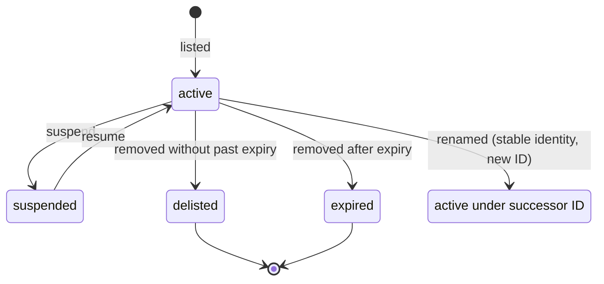

# Instruments domain

Pure, deterministic instrument IDs, master fields, change detection and continuous-futures resolution. No framework or I/O. Implements FR-SY-1, FR-SY-2, FR-SY-4, FR-SY-5 and the domain portion of E23.

## Canonical ID parsing (FR-SY-1)

| Part | Rule |
| --- | --- |
| Input | Trim surrounding whitespace. |
| Separator | Split on the first colon; exchange and ticker must both be non-empty. Additional colons belong to the ticker. |
| Exchange | Uppercase; match `^[A-Z0-9_]{1,20}$`. |
| Ticker length | 1–64 characters. |
| Ticker characters | Reject U+0000–U+001F and U+007F; preserve inner spaces and punctuation. |
| Ticker case | Preserve case unless the whole input has no uppercase letter; then uppercase the ticker. |
| Failure | Throw framework-free `InvalidInstrumentIdError` with raw input, reason and `VALIDATION_FAILED`; `tryParse` returns null. |

## Master changes (FR-SY-4, E23)

Compare IDs first. Missing IDs with a matching stable identity (exchange plus ISIN by default, caller-supplied identity otherwise) produce a rename only when the successor ID was absent from the previous master, suppressing the successor's listing. Custom identity scoping is the caller's responsibility; the new-ID restriction always applies. Other missing IDs are expired only when expiry precedes the timestamp's date; otherwise they are delisted. New IDs are listed, and deep changes to any non-ID field are updated. Results sort by renamed, delisted, expired, listed, updated, then ID. Every change carries the caller's timestamp.

The diagram describes instrument status and rename history; this task models and detects changes without persisting or applying status transitions.

## Continuous futures (FR-SY-5, E23)

Continuous tickers end in a rank from 1 through 9 followed by `!`. Resolution selects futures with an underlying ticker equal to the root, falling back to a ticker prefix only when no underlying is present. Contracts must have expiry on or after the caller's date. Sort by ascending expiry and select rank minus one; return null when unavailable. The expiry date itself remains tradable; the following day rolls to the next contract.
