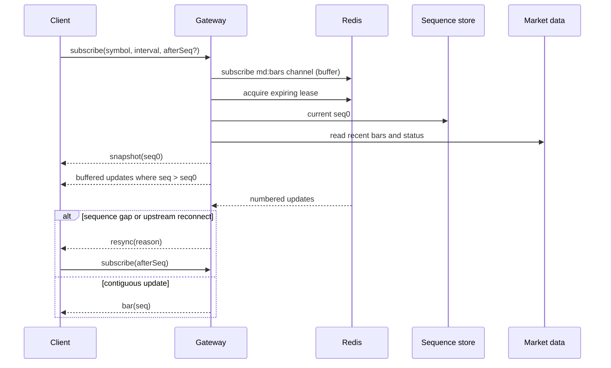
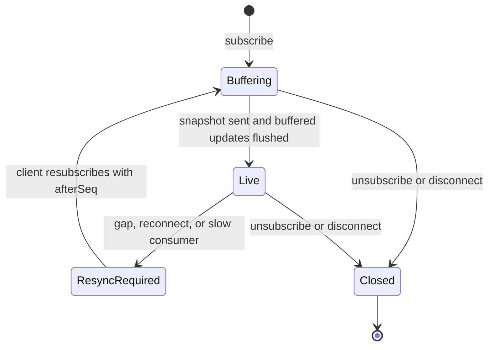

# Live socket gateway

**Purpose:** provide authenticated, replayable live market data with expiring subscription interest.

**SRD:** FR-LS-1, FR-LS-2, FR-LS-4, E10, E11, E16, E24, NFR-SC-1, NFR-RB-1.

The server uses one pattern subscribed Redis connection per API process. Active instrument leases are ZSET entries named `<instanceId>|<instrumentId>` and expire after 60 seconds; the process refreshes them every 20 seconds. `subscribe` and `unsubscribe` are strict Zod payloads and are rate limited to 20 operations per 10 seconds per socket. Each socket can hold 50 subscriptions and each user can hold 10 sockets. A slow transport over 1 MB receives one resync event while pending bar events are discarded.

## Browser client (`apps/web/src/shared/live`)

**Purpose:** one connection per page keeps every chart and price exactly in step with the server through drops, sleep, hidden tabs and offline periods, with no reload (FR-LS-3/4, E7–E11, E14, FR-UI-8).

### Connection states

```mermaid
stateDiagram-v2
  [*] --> connecting: start()
  connecting --> live: connect
  live --> reconnecting: disconnect
  connecting --> reconnecting: connect_error
  reconnecting --> connecting: backoff timer (full jitter, 500 ms → 15 s)
  reconnecting --> connecting: online / wake (reset backoff)
  live --> offline: offline event
  offline --> live: online (socket still up) + resync all
  connecting --> unauthorized: connect_error UNAUTHORIZED
  live --> unauthorized: session_expired
  unauthorized --> [*]: no retries; the UI sends the user to login
```

### Resync triggers
Each trigger resubscribes the series with `afterSeq = lastSeq`. The server then replays the missed updates, or sends a fresh snapshot when the gap is older than its 300-update history. Triggers that fire in the same turn collapse into one resubscribe per series.

| Trigger | Condition |
|---|---|
| Reconnect | Every `connect` |
| Server `resync` | `SEQ_GAP`, `UPSTREAM_RECONNECT`, `SLOW_CONSUMER` |
| Client gap | `bar.seq > lastSeq + 1` |
| Tab return | Hidden for 5 s or more, then visible |
| Network return | `online` |
| Wake from sleep | The 15 s tick arrives 30 s or more late |
| Stale guard | An `ok` series silent for 90 s (once, until the next event) |

### Merge rules (`SeriesSync`)
- `seq <= lastSeq` is dropped; `seq > lastSeq + 1` is a gap (not applied, resync).
- Bars are keyed by time; the server wins. A late correction to an older bar redraws the series.
- A snapshot keeps older paged-in history only if it overlaps; otherwise that history is dropped, so no hole is drawn.
- Paged history overwrites held bars except the newest (forming) bar.
