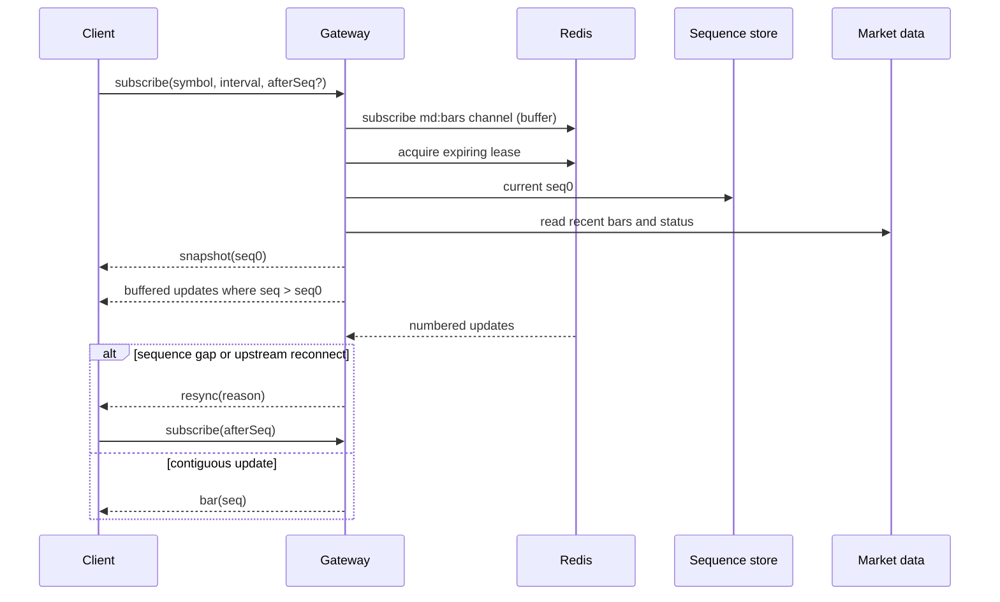
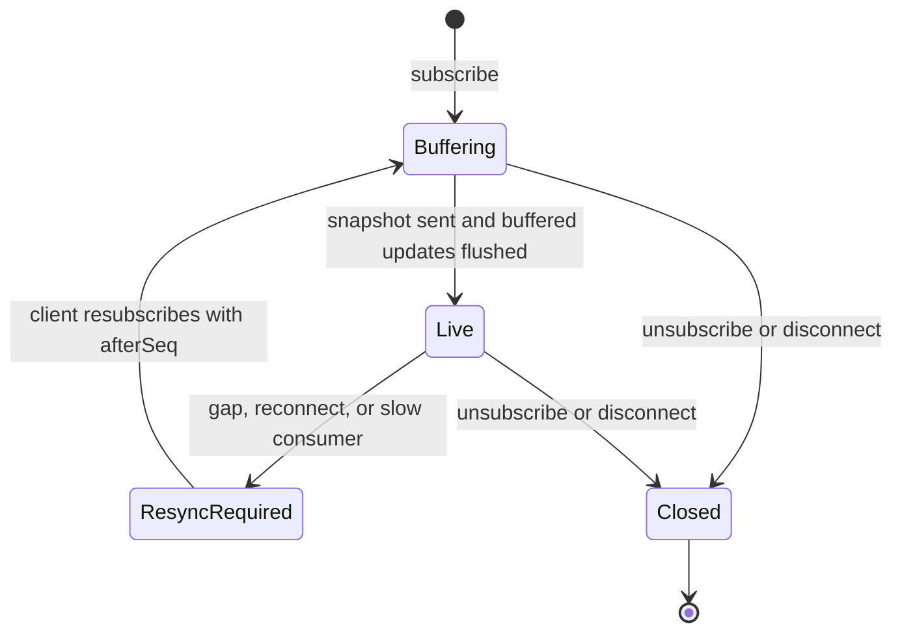

# Live socket gateway

**Purpose:** provide authenticated, replayable live market data with expiring subscription interest.

**SRD:** FR-LS-1, FR-LS-2, FR-LS-4, E10, E11, E16, E24, NFR-SC-1, NFR-RB-1.

The server uses one pattern subscribed Redis connection per API process. Active instrument leases are ZSET entries named `<instanceId>|<instrumentId>` and expire after 60 seconds; the process refreshes them every 20 seconds. `subscribe` and `unsubscribe` are strict Zod payloads and are rate limited to 20 operations per 10 seconds per socket. Each socket can hold 50 subscriptions and each user can hold 10 sockets. A slow transport over 1 MB receives one resync event while pending bar events are discarded.

