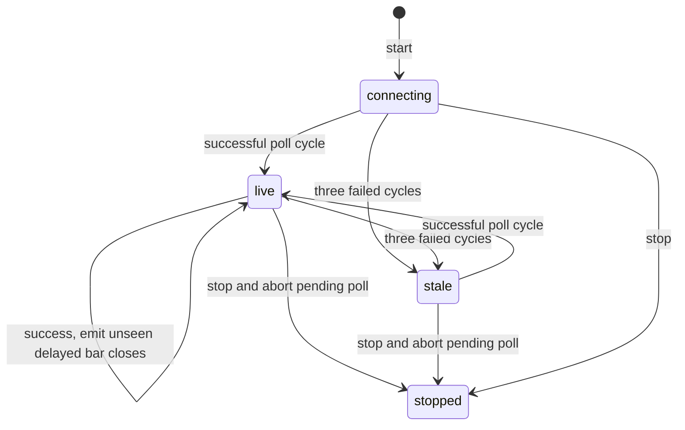
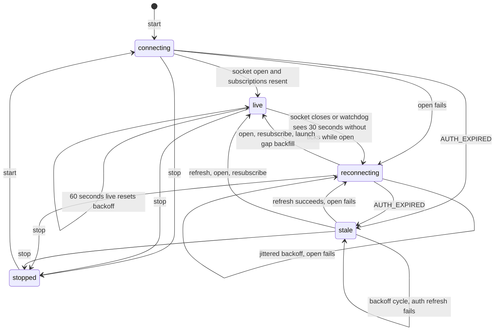
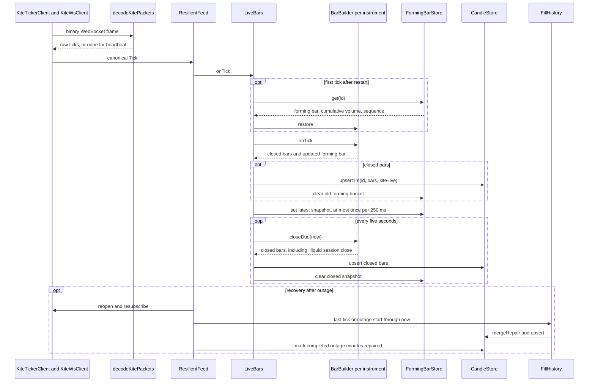
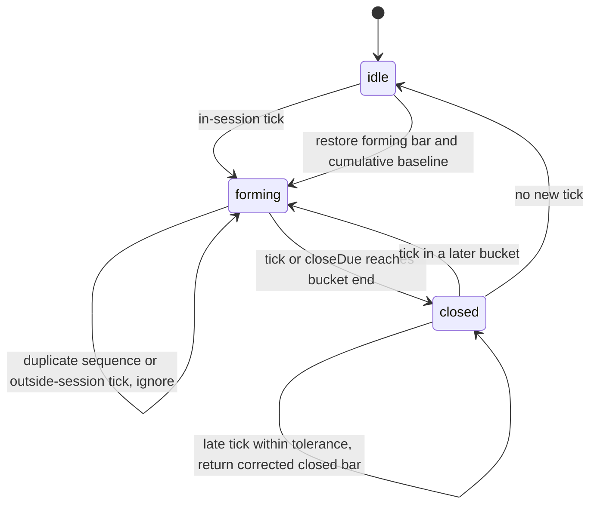
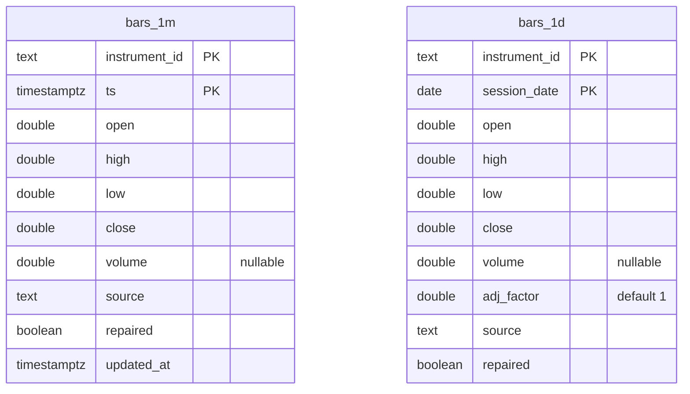
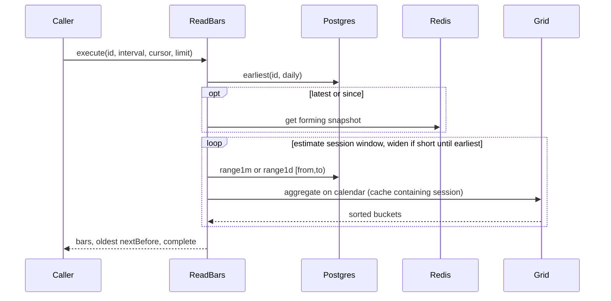
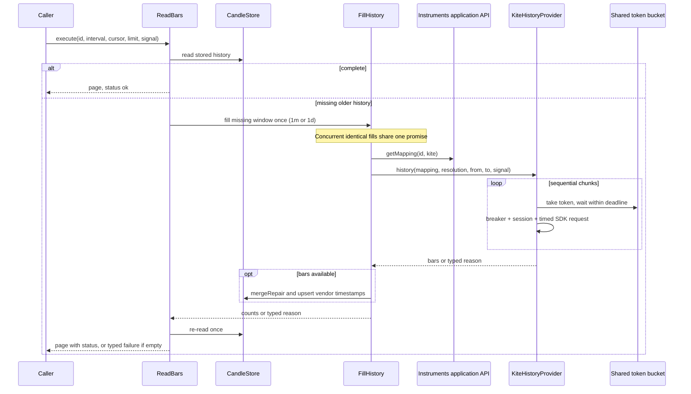
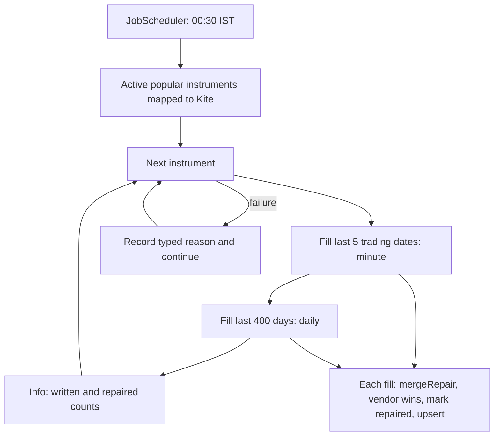

# Market data domain

## Deriv and US delayed adapters (P2-6)

FR-MD-1, FR-UI-8, E1, E2, E5 and E6. Providers return bars or typed reasons.
FillHistory routes canonical exchanges to their mapped provider and persists
that provider as provenance. DerivFeed uses ResilientFeed unchanged, including
the FX calendar watchdog and asynchronous gap repair. Both feeds are exported
for P2-9; module construction opens no connections. Failed Deriv gap repairs
join Kite's existing nightly retry hook.

| Vendor | Markets | Live or delayed | History limits | Volume |
| --- | --- | --- | --- | --- |
| Kite | NSE, BSE, MCX, NFO | Live socket | 1m: 60 days/request; 1d: 2,000 days/request | Real; null for indices |
| Deriv | 29 forex and metal instruments (FX/OANDA mappings) | Live socket | 1m and 1d; 1,000 candles/page backwards, at most 20 pages/call | Always null |
| US delayed (Yahoo) | US mapped exchanges | Polled, 15 minutes delayed | 1m: last 30 days, at most 7 days/request; 1d | Reported history volume; tick cumulative volume null |

Deriv uses `wss://api.derivws.com/trading/v1/options/ws/public` without an app ID.
Each history page uses a separate socket with req_id correlation and a 15-second deadline;
history never blocks the live socket. Three failed history calls open the
breaker for 60 seconds. MarketIsClosed returns MARKET_CLOSED and empty candles
return NO_DATA, including entirely closed windows. Live sockets
send a ping every 30 seconds and forget the subscription ID from the current
connection, including subscriptions cancelled before their acknowledgement.

```mermaid
sequenceDiagram
    participant Caller
    participant Feed as DerivFeed / ResilientFeed
    participant Socket as Deriv transport
    participant Vendor as Deriv
    participant Fill as FillHistory
    Caller->>Feed: subscribe(canonical IDs), start()
    Feed->>Socket: connect(signal), sendSubscribe(mapped symbols)
    Socket->>Vendor: ticks + subscribe=1 + req_id
    Vendor-->>Socket: tick + subscription.id
    Socket-->>Feed: canonical Tick(epoch * 1000, quote, null volume)
    loop every 30 seconds
        Socket->>Vendor: ping=1
    end
    Vendor--xSocket: drop, or silence during FX session
    Feed->>Socket: reconnect with jitter, resubscribe
    Vendor-->>Socket: tick + new subscription.id
    Feed->>Fill: missing minute range (asynchronous)
    loop backwards until from covered, including closed-market gaps (max 20 pages)
        Fill->>Vendor: separate socket: ticks_history, count=1000, end, req_id (no start)
        Vendor-->>Fill: candles or typed error
        Note over Fill: next end = oldest epoch - granularity; empty page moves back 1000 intervals
    end
    Caller->>Feed: unsubscribe (reference count and grace)
    Socket->>Vendor: forget=current subscription.id
```

UsDelayedFeed polls every 60 seconds only during open US sessions, rotating a
maximum of ten symbols per cycle with one second between requests. Overlapping
cycles are skipped. Only completed bars at least 15 minutes old emit ticks;
monotonic close timestamps prevent repeat emission. Consumers must inspect
`delayMs = 900000` even when transport state is `live`. Three unsuccessful cycles
emit `stale` with a reason; a successful cycle restores `live`. HTTP 429 includes
retryAfterMs 60000; unknown symbols are UNSUPPORTED. Three failed Yahoo calls
open the breaker for five minutes. Every call has an abortable 15-second timeout.



The manager-only smoke script `scripts/smoke/deriv-us.ts` reads XAUUSD minute
history for the last full hour before the most recent completed FX session close,
counts 60 seconds of ticks and reads AAPL daily history for ten days.
It prints counts or reason codes; automated work never
runs it.

## Live Kite feed (P2-5)

Requirements: FR-MD-2, FR-MD-4, FR-MD-5, E1, E2, E3, E11, E12, E16,
NFR-RB-1. `MarketDataModule.startFeeds()` attaches the bar pipeline and explicitly
starts feeds. The API process does not call it. P2-9 owns the market-data process.
`ResilientFeed` contains no vendor parsing, credentials or subscription layout.
It owns cancellable jittered recovery, subscription reference counts, grace,
market-aware silence detection and asynchronous gap repair. Failed repairs are
retained for the next nightly reconciliation, including non-popular instruments.



Kite uses full mode for real volume and LTP for indices. Missing timestamps in
LTP packets use receive time; full packets prefer exchange timestamp, then last
trade time. SubscriptionManager fills up to three groups of 3,000 instruments.
Each connection uses `KiteWsClient`, a direct `ws` transport with a 15-second
handshake deadline and abortable, bounded sends. `KiteTickerClient` coordinates
the pool; `ResilientFeed` alone owns retries. `decodeKitePackets` parses the five
documented packet sizes, signed segment-scaled prices, timestamps and depth.
One-byte heartbeats update socket liveness without emitting ticks; the feed's
market-aware watchdog still detects tick silence. Text error frames produce
sanitized warnings; auth errors and HTTP 401/403 close with `AUTH_EXPIRED`.
The adapter maps tokens back to canonical IDs. Authentication rejection explicitly
refreshes the session before obtaining its new access token; no fallback vendor.
Kite's SDK is used only for history and session, never for streaming.



The manager-only `scripts/smoke/kite-ticker.ts` accepts configuration JSON on
stdin. During NSE hours it resolves GOLD1!'s current contract, subscribes with
RELIANCE and NIFTY for three minutes, terminates the socket at 90 seconds and
prints tick counts, closed bars, repair flags and state transitions. It is never
run by automated tests.

Pure bars, market calendars, the session grid, tick aggregation and vendor repair.
Time is supplied by callers. Requirements: FR-CH-6, FR-MD-2, E11, E12, E13, E16.

## Grid rules

| Interval | Anchor | Closed-market behavior |
| --- | --- | --- |
| Intraday | Each session's open plus whole interval multiples | No bucket outside a session; final bucket clipped to close |
| FX intraday | UTC epoch multiples | No bucket outside Sunday 22:00–Friday 22:00 UTC |
| 1D | Midnight of the session date in the calendar timezone | No bucket on a nontrading date |
| FX 1D | Most recent 17:00 America/New_York cutover, including DST | No bucket outside FX sessions |
| 1W | Monday midnight of the ISO week in the calendar timezone | Input date must be a trading date |
| 1M | First day of the month at local midnight | Input date must be a trading date |

## Calendars

| Exchange | Timezone | Sessions |
| --- | --- | --- |
| NSE, BSE, NFO → NSE | Asia/Kolkata | Weekdays 09:15–15:30; curated 2026 closures; November 8 Muhurat 18:00–19:00, confirm yearly |
| MCX | Asia/Kolkata | Weekdays 09:00–23:30, or 23:55 during US DST; curated evening-only holidays open at 17:00 |
| NASDAQ, NYSE, NYSEARCA, AMEX, CBOE, IEX | America/New_York | Weekdays 09:30–16:00; computed NYSE holidays; applicable half days close at 13:00 |
| FX, OANDA | UTC | Sunday 22:00 through Friday 22:00; daily cutover uses New York timezone |

All session windows are half-open. Pre-open ticks produce no bars.
`holidaysKnownThrough(calendarId)` returns `2026-12-31` for NSE, BSE, NFO and
MCX, and `9999-12-31` for the computed US and FX calendars. Dates beyond the
curated Indian list use normal weekday sessions; no 2027 holidays are inferred.
Sources and every curated holiday date are recorded in the task result.

## Builder state



The minute start is the bar key. Sequence numbers make duplicate ticks idempotent.
Event timestamps determine open and close when ticks arrive out of order.
No-trade minutes produce no bars. Returned bars are snapshots.
Late tolerance is measured from the bar end to the latest supplied tick/closeDue
time (a monotonic watermark), inclusive at the tolerance boundary. Retained ticks
are ordered by event time so late cumulative ticks reallocate volume to the
correct bars. Any intervening closed bars whose volume changes are returned too.
The first cumulative tick establishes a baseline; a restored baseline is used
immediately. Missing cumulative data makes that bar's volume unknown.
Cumulative volume starts a fresh baseline on a new exchange-local trading date.

## Repair

Union live and vendor bars by UTC start time. Vendor OHLC or volume differences
replace the live values, set `repaired: true`, and increment `repairedCount`.
Matching live bars retain their repair flags. Vendor-only history is added;
live-only bars remain available until the vendor publishes them. Output is sorted.
Repeating an identical repair changes no bars and counts no new repairs.

## Candle storage (P2-3)

FR-MD-2 makes Postgres the candle source of truth. FR-CH-5 cursors use bar starts
in UTC milliseconds; FR-CH-6 aggregates with the domain session grid. NFR-RB-4
is enforced by composite primary keys and conditional OHLCV updates. Changed
bars retain a visible `repaired` flag; identical replays do not update rows.
Writes split into batches of at most 1,000 rows. Daily session dates are stored
as exchange-local dates and returned at exchange-local midnight expressed in UTC
milliseconds, matching the domain grid for weekly/monthly aggregation.
FX daily starts use the grid's 17:00 New York cutover, including DST.



`bars_1m` is range partitioned by UTC calendar month into `bars_1m_YYYYMM`.
Boot and `bars-partitions` (01:00 IST on each month's first day) create the
current month plus two ahead. Writes call the same idempotent SQL function
before inserting into any month. An advisory transaction lock serializes DDL.
`bars-retention` runs daily at 02:00 IST and drops attached partitions whose
month precedes the current IST month minus 24 months (Q5). It never deletes
individual rows. Daily history has no retention job.

Redis holds only transient forming data: hash `bar:forming:<id>`, field `value`,
JSON `{bar,cumVolume,seq}` with an atomic two-day expiry. Reads expose
`cumVolume` as `lastCumVolume`. ReadBars never persists this snapshot.



`before` is exclusive and `since` inclusive. Forming minutes merge before
aggregation only when newer than persisted minutes. Short pages lacking older
stored history report `complete=false` for P2-4 read-through. The NFR-PF-2
integration test measures a full 5,000-bucket page against real containers.

## Kite history and read-through (P2-4)

FR-MD-1 defines `MarketDataProvider.history`: a `ProviderResult<Bar[]>`, never
null. The injected `MARKET_DATA_PROVIDERS` map contains Kite, Deriv and US delayed.
InstrumentHistory exposes mappings through the instruments application API.
Canonical volume metadata travels with the mapping: indices have null volume;
zero equity/futures volume stays zero. The adapter also recognizes index tokens
when callers supply only the required mapping fields. Vendor tokens, intervals, timestamps and
error shapes are interpreted only inside the Kite adapter. Continuous IDs ending
in `1!` return UNSUPPORTED with `continuous history arrives in P2-8`.

| Reason | Meaning and handling |
| --- | --- |
| NO_DATA | Empty history window; does not trip the breaker |
| MARKET_CLOSED | Reserved typed outcome; closed markets do not prevent historical reads |
| UNSUPPORTED | Missing mapping/token, unknown instrument, deferred continuous history; does not trip the breaker |
| RATE_LIMITED | Redis wait exhausted, HTTP 429, Too many NetworkException; includes retry delay (E4) |
| PROVIDER_DOWN | Network/server/timeout/invalid payload failure or open breaker (E6) |
| AUTH_EXPIRED | TokenException; no substitution from another vendor (E3) |

FR-MD-4 uses Redis key `rl:kite:history`, capacity 3, refill 3/second. Lua uses
Redis TIME to refill and consume atomically across processes. Waiters use
abortable resilience sleep and a default 30-second deadline. Each sequential
chunk takes a token: at most 60 days for minute or 2,000 days for daily. SDK
request dates are IST; returned starts become UTC epoch milliseconds. SDK and
caller-facing timeouts are 15 seconds. Cancellation stops waiting and subsequent
chunks; the SDK has no per-request AbortSignal parameter, so its underlying
request remains bounded by its own timeout. Three provider failures open the
breaker for 60 seconds; open calls fail before token or session access.



Failed fills with existing bars return `status: {ok:false,reason,detail?}`
(stale); without bars they return the ProviderResult failure itself. Successful
fills followed by empty reads return NO_DATA. Timestamp keys and conditional
upserts make identical fills idempotent. Repairs preserve live-only bars and
write vendor timestamps with source `kite`.

## Nightly reconciliation (FR-MD-2)

`bars-backfill`: cron `30 0 * * *`, Asia/Kolkata, six-hour catch-up grace,
45-minute runtime. Held means active popular-list instruments mapped to Kite;
watchlists are deferred. Minute history starts at the open of the fifth most
recent completed trading date, honoring holidays and special sessions. Daily
history covers 400 calendar days. Info logs contain counts or a typed reason
per instrument. RATE_LIMITED runs use resilience retries with jitter and at least
a one-second wait before each retry. Composite candle keys make replays safe.



The manager-only `scripts/smoke/kite-history.ts` loads configuration, mints a
session, uses the shared Redis bucket and prints RELIANCE minute and NIFTY daily
counts and first/last starts in IST. Automated tests use fake Kite clients.
