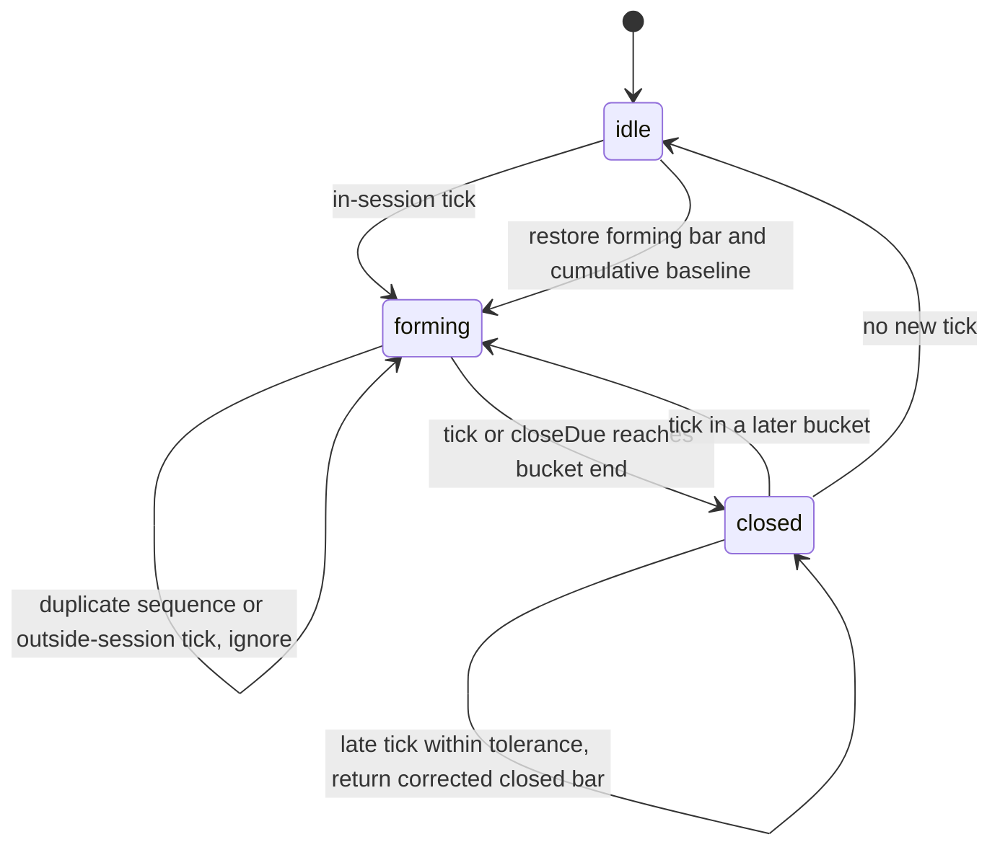

# Market data domain

Pure bars, market calendars, the session grid, tick aggregation and vendor repair.
Time is supplied by callers. Requirements: FR-CH-6, FR-MD-2, E11, E12, E13, E16.

## Grid rules

| Interval | Anchor | Closed-market behavior |
| --- | --- | --- |
| Intraday | Each session's open plus whole interval multiples | No bucket outside a session; final bucket clipped to close |
| FX intraday | UTC epoch multiples | No bucket outside Sunday 22:00–Friday 22:00 UTC |
| 1D | Midnight of the session date in the calendar timezone | No bucket on a nontrading date |
| FX 1D | Most recent 17:00 America/New_York cutover, including DST | No bucket outside FX sessions |
| 1W | Monday midnight of the ISO week in the calendar timezone | Input date must be a trading date |
| 1M | First day of the month at local midnight | Input date must be a trading date |

## Calendars

| Exchange | Timezone | Sessions |
| --- | --- | --- |
| NSE, BSE, NFO → NSE | Asia/Kolkata | Weekdays 09:15–15:30; curated 2026 closures; November 8 Muhurat 18:00–19:00, confirm yearly |
| MCX | Asia/Kolkata | Weekdays 09:00–23:30, or 23:55 during US DST; curated evening-only holidays open at 17:00 |
| NASDAQ, NYSE, NYSEARCA, AMEX, CBOE, IEX | America/New_York | Weekdays 09:30–16:00; computed NYSE holidays; applicable half days close at 13:00 |
| FX, OANDA | UTC | Sunday 22:00 through Friday 22:00; daily cutover uses New York timezone |

All session windows are half-open. Pre-open ticks produce no bars.
`holidaysKnownThrough(calendarId)` returns `2026-12-31` for NSE, BSE, NFO and
MCX, and `9999-12-31` for the computed US and FX calendars. Dates beyond the
curated Indian list use normal weekday sessions; no 2027 holidays are inferred.
Sources and every curated holiday date are recorded in the task result.

## Builder state

The minute start is the bar key. Sequence numbers make duplicate ticks idempotent.
Event timestamps determine open and close when ticks arrive out of order.
No-trade minutes produce no bars. Returned bars are snapshots.
Late tolerance is measured from the bar end to the latest supplied tick/closeDue
time (a monotonic watermark), inclusive at the tolerance boundary. Retained ticks
are ordered by event time so late cumulative ticks reallocate volume to the
correct bars. Any intervening closed bars whose volume changes are returned too.
The first cumulative tick establishes a baseline; a restored baseline is used
immediately. Missing cumulative data makes that bar's volume unknown.
Cumulative volume starts a fresh baseline on a new exchange-local trading date.

## Repair

Union live and vendor bars by UTC start time. Vendor OHLC or volume differences
replace the live values, set `repaired: true`, and increment `repairedCount`.
Matching live bars retain their repair flags. Vendor-only history is added;
live-only bars remain available until the vendor publishes them. Output is sorted.
Repeating an identical repair changes no bars and counts no new repairs.
