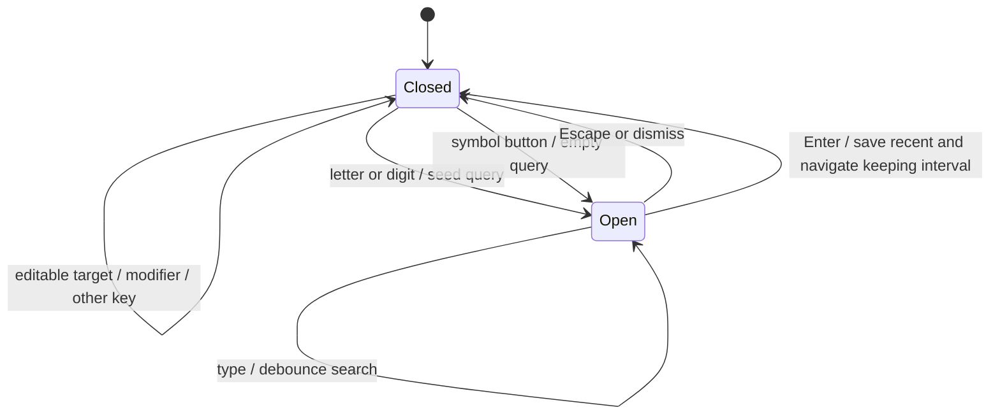

# Symbol search

FR-SY-6, FR-UI-9: the terminal opens instrument search from its symbol button or an unmodified letter/digit outside editable controls. Command provides arrow navigation and Enter selection; Radix Dialog handles Escape and focus restoration.

FR-UI-6, FR-UI-7: six skeleton rows cover first load; previous results remain during refresh with a progress indicator. Empty results explain the query; failures display the contract error code and Retry.



```mermaid
sequenceDiagram
    participant User
    participant Dialog
    participant Query as TanStack Query
    participant API as apiFetch
    participant Router
    User->>Dialog: Type query, choose exchange/type
    Dialog->>Dialog: Debounce query 150 ms
    Dialog->>Query: instruments/search/q/exchange/type
    Query->>API: GET v1/instruments/search (limit=20, AbortSignal)
    Note over Query,API: Unobserved requests abort; apiFetch enforces 15 s timeout
    API-->>Query: Validated InstrumentSearchResponseSchema or ApiError
    Query-->>Dialog: Results / empty / error with Retry
    User->>Dialog: Enter selected ID
    Dialog->>Dialog: Save 10 unique recent IDs through safeStorage
    Dialog->>Router: /terminal with previous search + symbol
    Note over Router: Plain URLSearchParams preserves interval without JSON quotes
```

Recent IDs appear above popular defaults for an empty query. Storage failure is a no-op; the API remains usable.
