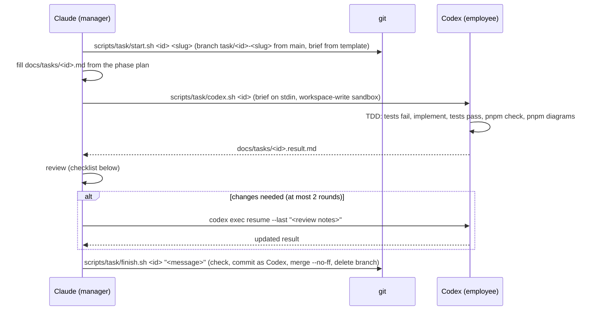

# Workflow — manager → employee

**Roles:**
- **Claude, the manager:** plans, writes briefs, reviews, owns the diagrams model, and merges.
- **Codex, the employee:** implements one brief at a time.
- **The owner:** sets direction and approves the SRD and plans.

**Rule:** nothing reaches `main` unless the manager has reviewed it and `pnpm check` passed on the branch.

## The loop

**Why the manager commits:** Codex's sandbox can't write `.git`. This was verified with `codex-cli 0.163.0`, including with `--add-dir .git`. The commit is authored `Codex <codex@users.noreply.local>`; the manager is the committer.

**If Codex can't finish after 2 review rounds:** the manager splits the task into smaller briefs on fresh branches and deletes the failed branch. Partial work is never merged.

## Review checklist (every branch)

1. **Scope:** the diff matches the brief; nothing extra. Follow-ups are listed, not done.
2. **Tests first:** the brief's test names exist, assert the brief's values, and failed before the implementation (the result file shows it).
3. **SRD:** every cited requirement and failure mode (`E…`) has a test.
4. **Layers:** R-1…R-12 hold; `pnpm depcruise` is clean; no rule config was weakened.
5. **Quality:** no `any`, no casts to silence types, no `process.env` outside `main.ts`, no dead exports (knip), no new duplication (jscpd).
6. **Resilience:** timeouts, cancellation, shared retry and breaker helpers, idempotency, a degraded state that's visible.
7. **Errors:** codes come from contracts, the body shape is right, no leaks.
8. **Web:** no fetch outside `shared/api`, no ticks in React state, components ≤ 250 lines, theme tokens only.
9. **Diagrams:** the feature README is updated; `pnpm diagrams:check` passes.
10. **Hygiene:** exact versions, no secrets, no commented-out code, no history-narrating comments.
11. **Verified by the manager:** the manager reruns `pnpm check` and doesn't rely on the result file's claim.

## Commands

| Command | Who | What |
|---|---|---|
| `scripts/task/start.sh <id> <slug>` | manager | Branch `task/<id>-<slug>` from `main`; create `docs/tasks/<id>.md` from the template. |
| `scripts/task/codex.sh <id>` | manager | Run Codex on the brief; the output goes to `docs/tasks/<id>.result.md`; the log to `.superpowers/codex/<id>.log`. |
| `codex exec resume --last "<notes>" < /dev/null` | manager | Send review notes back to the same Codex session. |
| `scripts/task/finish.sh <id> "<message>"` | manager | Run the checks, commit as Codex, merge with `--no-ff`, delete the branch. |

**Tasks before the check script exists** (Phase 0, Tasks 1–2): `finish.sh` runs whichever of `check`, `test` is defined, and says so when neither is.
